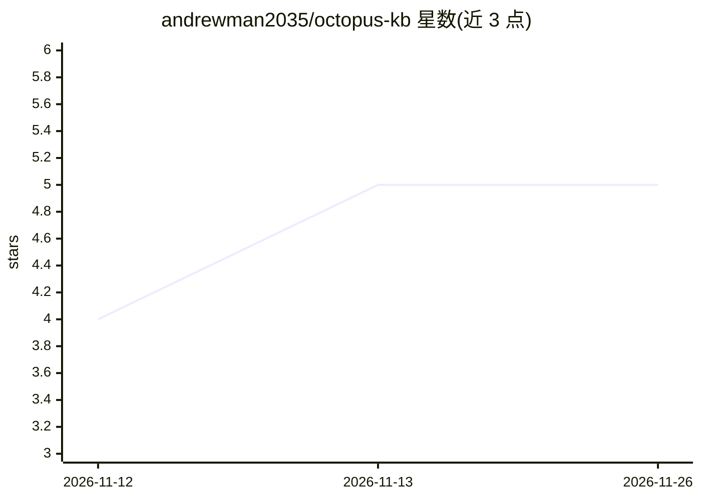

# andrewman2035/octopus-kb

⭐ 5 · Python · MIT · 推送 2026-10-30 · [GitHub](https://github.com/andrewman2035/octopus-kb) · 个人维护 · 中文 README

**自托管个人 AI 知识库：转发链接即存档、转录、总结与溯源问答**

通过 Telegram/Discord/飞书/微信/邮件/Chrome 扩展等入口收链接、截图、文件与语音，读取、OCR 或转录后生成带 YAML front matter 的 Markdown 笔记存于本机磁盘，数据库仅为可重建缓存。问答基于混合检索（中文分词全文+向量）从已存笔记回答并给出编号引用。支持 Claude 订阅（经 Claude Code）、API key、OpenAI 兼容服务或 Ollama 本地模型，需 Python 3.12（uv）、Ollama bge-m3 嵌入、ffmpeg。

## 筛选速览

| 维度 | 判定 | 备注 |
|---|---|---|
| AI 角色 | `ai-native` | 本体是模型或模型工具 |
| 许可风险 | `permissive` | MIT |
| 部署形态 | `desktop` | 安装包/桌面程序 |
| 模型依赖 | local-ok | 支持本地模型 |
| 硬件要求 | — | 无带数字的原话,不猜 |
| 安装摩擦 | `low` | 无编译、无系统依赖或容器化 |
| 成熟度 | — | 结构信号不足 |

## 能力要点

- 多入口保存：聊天应用、Chrome 扩展、macOS 快捷指令、终端、邮件
- 支持微信公众号全文、YouTube/B 站视频、播客、小红书等中文平台
- 每条笔记为一个 Markdown 文件，可放入 Obsidian vault 并双向同步
- 混合检索（中文分词全文+向量）与编号引用，无相关内容时如实说明

## 适用场景

- 在聊天应用里转发链接即可存档为本地 Markdown 笔记
- 稍后基于自己保存的资料提问并获得引用来源
- 把第二大脑笔记直接放进 Obsidian 管理编辑
- 用 Ollama 本地模型完全离线运行知识库

## 场景标签

`知识库管理` `RAG` `语音识别` `OCR` · 领域:知识与检索

## 证据(README 行号)

> L10: it reads, transcribes and summarizes them into Markdown notes on your own disk, and answers your questions from
> L28: - **Your notes, your disk.** Every entry is a plain `.md` file with a summary, key points and tags. Put the folder 
> L52: - **Answers from your notes**: hybrid search (full-text with Chinese segmentation plus vector search), numbered
> L71: - Ollama with `ollama pull bge-m3` (embeddings for search; required). For a local model:

## 星数曲线

2026-11-12 4 → 2026-11-26 5（+1）

---
*卡片 v1 · prompt 1.4 · 生成 2026-11-21 · 置信度 high · 依据 README sha `6d8dbf68b5f0` · [字段定义](../../DATASET.md)*
