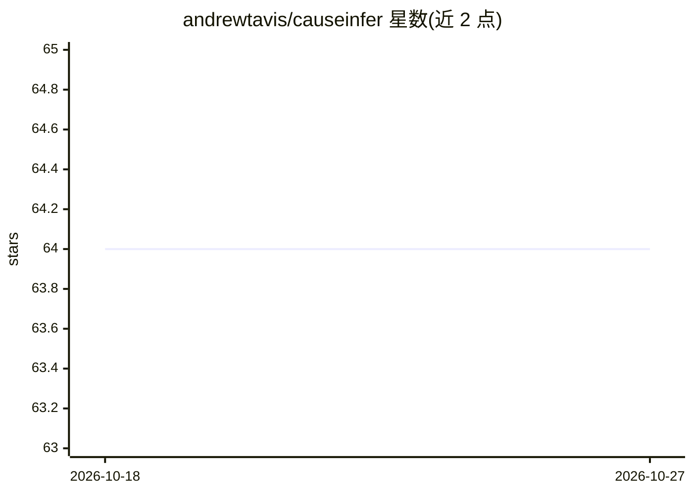

# andrewtavis/causeinfer

⭐ 64 · Python · BSD-3-Clause · 推送 2026-10-23 · [GitHub](https://github.com/andrewtavis/causeinfer) · 个人维护

**Python 因果推断/uplift 机器学习库：估计处理效应**

用于估计平均处理效应（ATE）与条件平均处理效应（CATE）的 Python 包。提供 Two Model、Interaction Term、二/四类转换、Reflective 与 Pessimistic Uplift 等标准算法，配套累计增益与 Qini 曲线等评估可视化、模型迭代方差分析，以及 Hillstrom 邮件营销、Mayo PBC、CMF 小额信贷等业务/医学/社会经济示例数据集的下载与格式化工具。面向商业、医学与社会经济领域学习因果推断的用户，高级算法（GRF、X-Learner、双重机器学习等）列为待纳入。

## 筛选速览

| 维度 | 判定 | 备注 |
|---|---|---|
| AI 角色 | `ai-native` | 本体是模型或模型工具 |
| 许可风险 | `permissive` | BSD-3-Clause |
| 部署形态 | `library` | 以包/库形式分发 |
| 模型依赖 | — | README 未给出锁定关系 |
| 硬件要求 | — | 无带数字的原话,不猜 |
| 安装摩擦 | `low` | 无编译、无系统依赖或容器化 |
| 成熟度 | — | 结构信号不足 |

## 能力要点

- 6 种标准 uplift/因果算法（Two Model、类转换、加权 Uplift 等）
- 累计增益/Qini 曲线可视化评估与模型迭代方差分析
- 内置 Hillstrom、Mayo PBC、CMF Microfinance 数据集的下载与格式化模块
- uv/pip 安装，Python >=3.12 开发环境

## 适用场景

- 营销活动做 uplift 建模，找出对处理最敏感的人群
- 医学试验中估计处理效应并可视化评估
- 学习不同因果推断算法在各数据集上的表现差异

## 场景标签

 · 领域:因果推断/数据科学

## 证据(README 行号)

> L13: ## Machine learning based causal inference/uplift in Python
> L15: **causeinfer** is a Python package for estimating average and conditional average treatment effects using machine l

## 星数曲线

2026-10-18 64 → 2026-10-27 64（+0）

---
*卡片 v1 · prompt 1.4 · 生成 2026-10-24 · 置信度 high · 依据 README sha `fcd09fc58694` · [字段定义](../../DATASET.md)*
