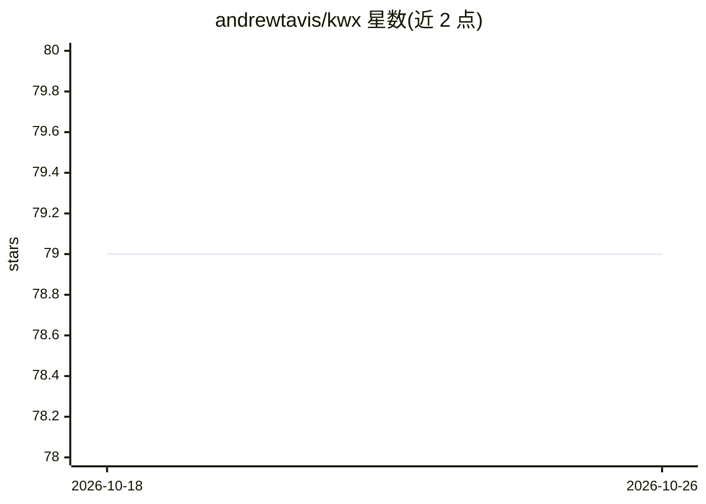

# andrewtavis/kwx

⭐ 79 · Python · BSD-3-Clause · 推送 2026-10-24 · [GitHub](https://github.com/andrewtavis/kwx) · 个人维护

**面向多语言文本的关键词提取 Python 工具包（BERT/LDA/TFIDF）**

kwx 是一个多语言关键词提取工具包，提供 BERT（基于 sentence-transformers 预训练模型）、LDA、TFIDF 与词频四种方法，从文本语料中提取并分析关键词，附带 t-SNE、pyLDAvis、词云等可视化功能。特色机制是允许用户指定不纳入输出的词，模型会重复运行直至剔除不合理的词。支持任意语言文本的处理（语言支持程度见 kwx.languages），通过 uv 或 pip 安装，面向需要分析调查、推文、论文等文本的数据分析用户。

## 筛选速览

| 维度 | 判定 | 备注 |
|---|---|---|
| AI 角色 | `ai-native` | 本体是模型或模型工具 |
| 许可风险 | `permissive` | BSD-3-Clause |
| 部署形态 | `library` | 以包/库形式分发 |
| 模型依赖 | — | README 未给出锁定关系 |
| 硬件要求 | — | 无带数字的原话,不猜 |
| 安装摩擦 | `low` | 无编译、无系统依赖或容器化 |
| 成熟度 | — | 结构信号不足 |

## 能力要点

- BERT/LDA/TFIDF/词频四种关键词提取方法
- 支持多语言文本，语言覆盖程度分级列出
- 用户可指定排除词，模型迭代重跑直至输出合理
- 提供主题数评估、t-SNE、pyLDAvis、词云等可视化

## 适用场景

- 从调查问卷或社交媒体文本中提取关键词
- 对比语料与参照文本提取 TFIDF 关键词
- 生成词云和主题可视化用于结果汇报

## 场景标签

`数据分析` · 领域:效率与自动化

## 证据(README 行号)

> L15: **kwx** is a toolkit for multilingual keyword extraction based on Google's BERT, Latent Dirichlet Allocation and Te
> L52: Implemented NLP modeling methods within kwx.model include:

## 星数曲线

2026-10-18 79 → 2026-10-26 79（+0）

---
*卡片 v1 · prompt 1.4 · 生成 2026-10-24 · 置信度 high · 依据 README sha `47afa8aaf382` · [字段定义](../../DATASET.md)*
