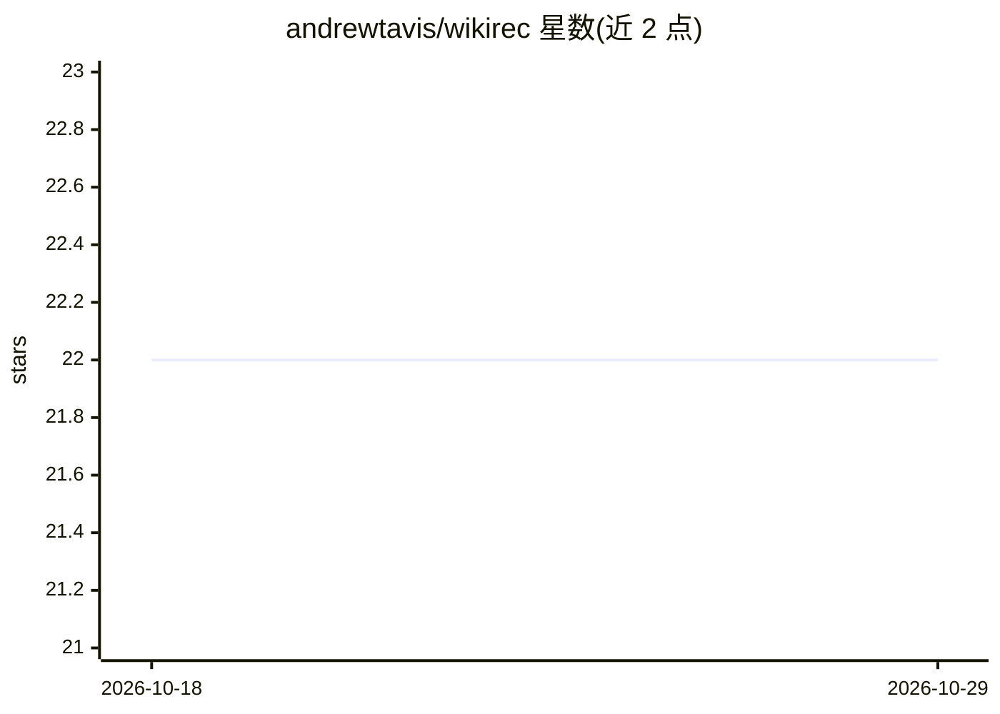

# andrewtavis/wikirec

⭐ 22 · Python · BSD-3-Clause · 推送 2026-02-21 · [GitHub](https://github.com/andrewtavis/wikirec) · 个人维护

**基于维基百科数据的内容推荐引擎框架**

wikirec 是一个 Python 推荐框架：从任意语言的维基百科 dump 下载并解析指定 infobox 类型的条目（书籍、电影、音乐等），经多语言清洗流程生成语料，再基于无监督 NLP 模型（BERT/sentence-transformers、Doc2vec、LDA、TFIDF、WikilinkNN）生成文章嵌入与相似度矩阵，输出内容推荐；用户评分可作为权重表达偏好。面向希望仅用开源数据构建内容推荐的开发者，通过 PyPI 提供安装，附 Colab 可运行的示例 notebook。README 的对比结果显示 TFIDF 运行时间最短，Doc2vec 表现较差。

## 筛选速览

| 维度 | 判定 | 备注 |
|---|---|---|
| AI 角色 | `ai-native` | 本体是模型或模型工具 |
| 许可风险 | `permissive` | BSD-3-Clause |
| 部署形态 | `library` | 以包/库形式分发 |
| 模型依赖 | — | README 未给出锁定关系 |
| 硬件要求 | — | 无带数字的原话,不猜 |
| 安装摩擦 | `low` | 无编译、无系统依赖或容器化 |
| 成熟度 | — | 结构信号不足 |

## 能力要点

- 解析任意语言维基百科 dump 并按 infobox 类型筛选条目
- 支持 BERT/Doc2vec/LDA/TFIDF/WikilinkNN 五种嵌入方法
- 余弦或欧氏相似度矩阵生成推荐，支持相似度矩阵加权组合
- 用户评分加权推荐以表达偏好

## 适用场景

- 为书籍、电影等内容条目构建基于维基百科文本的相似推荐
- 用评分数据加权调整推荐结果
- 对比不同 NLP 建模方法在推荐任务上的效果

## 场景标签

`推荐系统` · 领域:学习与行业

## 证据(README 行号)

> L14: **wikirec** is a framework that allows users to parse Wikipedia in any language for entries of a given type and the

## 星数曲线

2026-10-18 22 → 2026-10-29 22（+0）

---
*卡片 v1 · prompt 1.4 · 生成 2026-10-27 · 置信度 high · 依据 README sha `c9f64361f170` · [字段定义](../../DATASET.md)*
