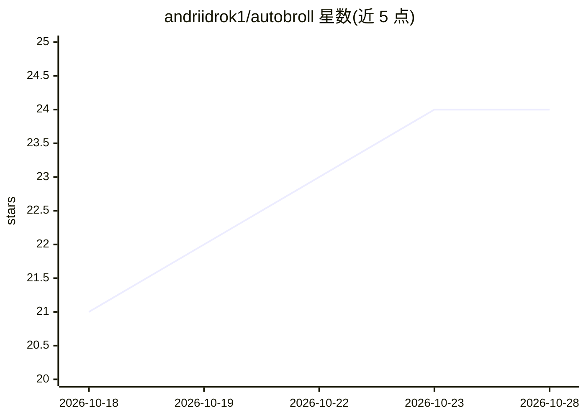

# andriidrok1/autobroll

⭐ 24 · TypeScript · MIT · 推送 2026-09-29 · [GitHub](https://github.com/andriidrok1/autobroll) · 个人维护

**浏览器内 AI 短视频剪辑器：自动排序、去静音、字幕与 B-roll**

基于 Remotion 的本地运行短视频剪辑工具：导入原始素材后，WhisperX 做词级转录，Gemini 参与叙事排序、字幕重点词选取与人脸感知的字幕位置，支持自动剪除静音、自动 B-roll（优先用用户素材，备选 Pexels），并提供 CapCut 式时间线、关键帧、变速、音乐自动闪避与 mp4 导出。另内置 MCP 服务器（24 个工具），可由 Claude 通过对话编辑项目。需 Node 20+、ffmpeg、Python 3.10+，唯一网络调用为 Gemini 与 Pexels API。

## 筛选速览

| 维度 | 判定 | 备注 |
|---|---|---|
| AI 角色 | `ai-native` | 本体是模型或模型工具 |
| 许可风险 | `permissive` | MIT |
| 部署形态 | `library` | 以包/库形式分发 |
| 模型依赖 | locked-api |  |
| 硬件要求 | — | 无带数字的原话,不猜 |
| 安装摩擦 | `medium` | 含编译或系统依赖之一 |
| 成熟度 | — | 结构信号不足 |

## 能力要点

- WhisperX 词级转录 + Gemini 选取重点词与人脸感知字幕放置
- Auto-arrange / Autocut / Auto B-roll 一键 AI 流水线
- CapCut 式时间线：关键帧、变速、音乐自动闪避、mp4 导出
- 内置 MCP 服务器（24 个工具），可由 Claude 对话式编辑项目

## 适用场景

- 把口播原始素材自动整理成可发布的短视频
- 自动生成措辞自然的字幕并避开人脸放置
- 用对话让 Claude 帮我剪辑时间线并渲染草稿

## 场景标签

`图像视频处理` · 领域:感知与多模态

## 证据(README 行号)

> L3: An AI short-form video editor that runs in your browser. Drop in your raw takes — it listens to them, puts them in n
> L18: - **Generate Captions** — WhisperX word-level transcription → phrase-aware caption pages → Gemini picks the few wor

## 星数曲线

2026-10-18 21 → 2026-10-28 24（+3）

---
*卡片 v1 · prompt 1.4 · 生成 2026-10-27 · 置信度 mid · 依据 README sha `da3d40831701` · [字段定义](../../DATASET.md)*
