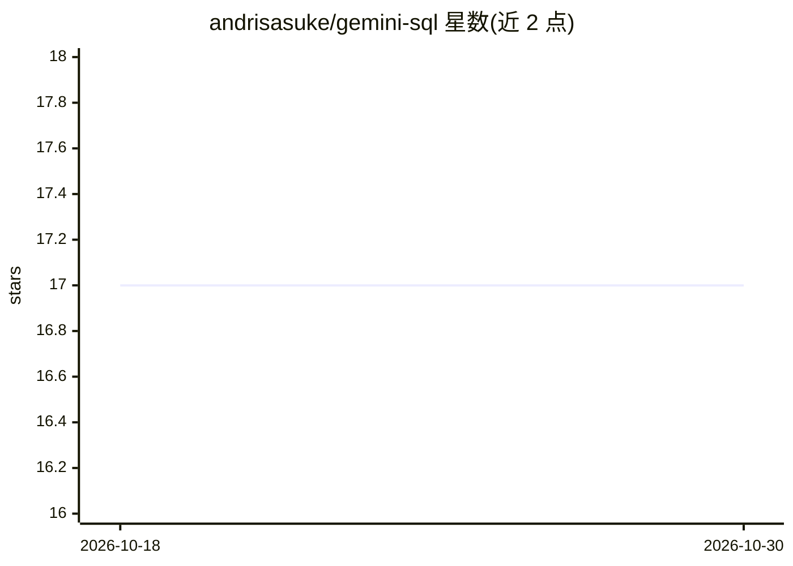

# andrisasuke/gemini-sql

⭐ 17 · TypeScript · MIT · 推送 2026-01-28 · [GitHub](https://github.com/andrisasuke/gemini-sql) · 个人维护

**带 AI 查询生成功能的跨平台 SQL 编辑器（Tauri + React + Rust）**

基于 Tauri 2.0、React 19 与 Rust 构建的 MySQL 桌面编辑器：多标签查询编辑、上下文 SQL 自动补全、Schema 浏览、虚拟化结果表格、查询保存与历史、多连接管理。AI 功能包括自然语言生成 SQL（通过 Google Gemini API，需用户自备 API key，调用直连 Google 不经代理）、AI 解释查询、schema 感知生成，可选 Gemini 2.5 Pro/2.5 Flash/3 Pro 模型。提供 macOS/Windows/Linux 安装包，也可从源码构建；PostgreSQL 与更多 LLM 提供商在路线图中尚未实现。

## 筛选速览

| 维度 | 判定 | 备注 |
|---|---|---|
| AI 角色 | `ai-enhanced` | 去掉 AI 部分产品仍成立 |
| 许可风险 | `permissive` | MIT |
| 部署形态 | `desktop` | 安装包/桌面程序 |
| 模型依赖 | — | README 未给出锁定关系 |
| 硬件要求 | — | 无带数字的原话,不猜 |
| 安装摩擦 | `low` | 无编译、无系统依赖或容器化 |
| 成熟度 | — | 结构信号不足 |

## 能力要点

- 自然语言描述生成 SQL，AI 感知数据库 schema
- 支持 Gemini 2.5 Pro / 2.5 Flash / Gemini 3 Pro Preview 模型选择
- 多标签编辑器、智能补全、查询保存与历史
- AI 调用从本地直连 Google API，不经应用代理

## 适用场景

- 日常编写和执行 MySQL 查询，管理多个数据库连接
- 用自然语言描述需求让 AI 生成 SQL 并获得解释
- 浏览数据库 schema 辅助写查询

## 场景标签

`代码生成` `数据分析` · 领域:效率与自动化

## 证据(README 行号)

> L5:  A modern, cross-platform SQL editor with AI-powered query generation
> L32: - **AI Query Generation** - Describe what you need in plain English, get SQL queries instantly
> L135: - [ ] **PostgreSQL Support** - Full support for PostgreSQL databases

## 星数曲线

2026-10-18 17 → 2026-10-30 17（+0）

---
*卡片 v1 · prompt 1.4 · 生成 2026-10-29 · 置信度 high · 依据 README sha `82ca138e5e8e` · [字段定义](../../DATASET.md)*
