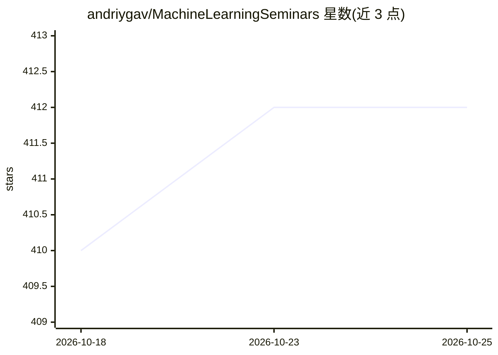

# andriygav/MachineLearningSeminars

⭐ 412 · Jupyter Notebook · MIT · 推送 2026-10-16 · [GitHub](https://github.com/andriygav/MachineLearningSeminars) · [官网](https://andriygav.github.io/MachineLearningSeminars/) · 个人维护

**机器学习课程的研讨课 notebook 与作业合集（俄语）**

A. V. Grabovoy 为 K. V. Vorontsov 机器学习课程配套的研讨课材料仓库，覆盖两学期主题：线性方法与 SGD、SVM、PCA、度量方法、逻辑分类器、关联规则、集成与梯度提升（XGBoost/CatBoost）、贝叶斯分类、聚类，以及卷积/循环网络、自编码器、GAN、文本向量化（Word2Vec/FastText）等。每讲含理论要点、Jupyter notebook 实践与课后作业，并链接课程讲义与 YouTube 讲座播放列表。以俄语撰写，面向上课学生。

## 筛选速览

| 维度 | 判定 | 备注 |
|---|---|---|
| AI 角色 | `ai-knowledge` | 知识聚合/清单类 |
| 许可风险 | `permissive` | MIT |
| 部署形态 | `None` |  |
| 模型依赖 | — | README 未给出锁定关系 |
| 硬件要求 | — | 无带数字的原话,不猜 |
| 安装摩擦 | `low` | 无编译、无系统依赖或容器化 |
| 成熟度 | — | 结构信号不足 |

## 能力要点

- 17+ 个研讨课 Jupyter notebook，按主题组织
- 每讲附课后作业与截止安排
- 链接配套课程讲义与 YouTube 讲座播放列表
- 实践使用 sklearn/torch，覆盖从线性回归到 GAN/文本向量化

## 适用场景

- 配合 Vorontsov 机器学习课程自学或复习
- 按主题查找含代码示例的机器学习实践 notebook
- 获取结构化的课后作业题与数据集链接

## 场景标签

`教程课程` · 领域:学习与行业

## 证据(README 行号)

> L33: Вводный семинар
> L223: Глубокие Нейронные Сети. Сверточные нейросети и Рекурентные сети.

## 星数曲线

2026-10-18 410 → 2026-10-25 412（+2）

---
*卡片 v1 · prompt 1.4 · 生成 2026-10-21 · 置信度 high · 依据 README sha `60fdbf2d8483` · [字段定义](../../DATASET.md)*
