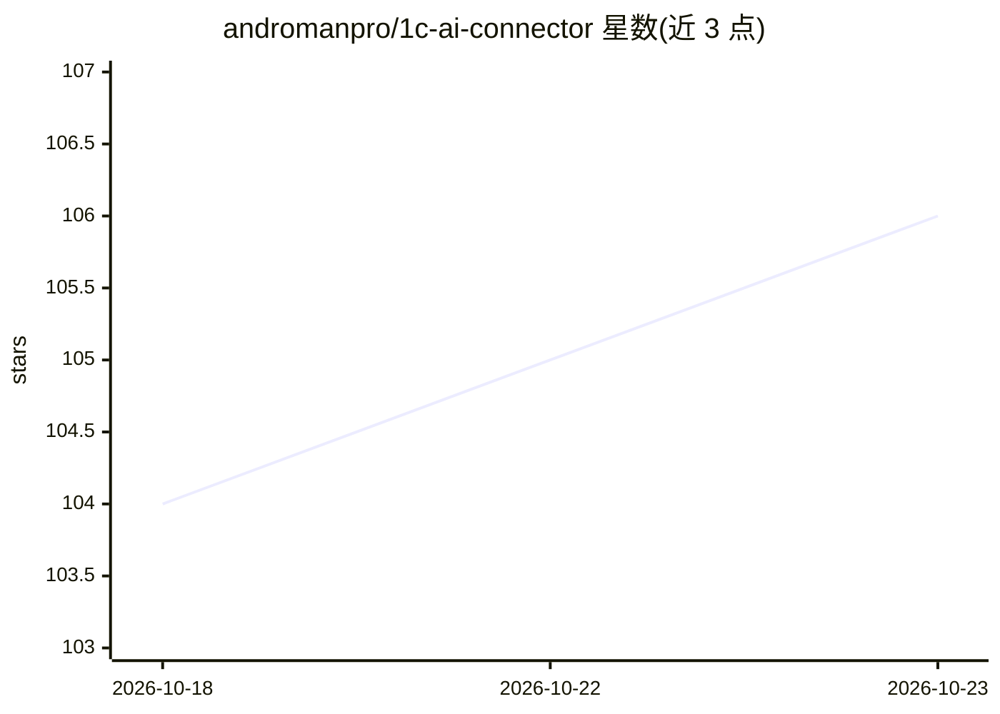

# andromanpro/1c-ai-connector

⭐ 106 · 1C Enterprise · MIT · 推送 2026-10-20 · [GitHub](https://github.com/andromanpro/1c-ai-connector) · [官网](https://androman.pro) · 个人维护 · 中文 README

**1С:Предприятие 8.3 的 LLM 集成扩展：连接器、Agent、RAG、MCP**

以配置扩展形式安装到 1С:Предприятие 8.3、不改主配置的 AI 子系统平台：统一 LLM 连接器（OpenAI 兼容、Anthropic、Google Gemini、YandexGPT、GigaChat 五种格式）、function calling 的代理循环、基于内置或 Qdrant 后端的知识库 RAG、供外部 AI 代理访问 1C 数据的 MCP 服务器（JSON-RPC 2.0、Basic Auth、白名单）、错误日志的 AI 分析与 Telegram 通知、按文本生成图表。发送前对文本做个人数据检测与替换（ Natasha 服务可选），并声明不检查附件内容、MCP 通道不在检查范围等限制。

## 筛选速览

| 维度 | 判定 | 备注 |
|---|---|---|
| AI 角色 | `ai-ecosystem` | LLM/agent 周边工具 |
| 许可风险 | `permissive` | MIT |
| 部署形态 | `None` |  |
| 模型依赖 | local-ok | 支持本地模型 |
| 硬件要求 | — | 无带数字的原话,不猜 |
| 安装摩擦 | `low` | 无编译、无系统依赖或容器化 |
| 成熟度 | — | 结构信号不足 |

## 能力要点

- 五种提供商格式统一连接器 + 25+ 预设模型
- function calling 代理循环，模型可调用 1C 工具并继续推理
- RAG 双后端：纯 1C 内置检索或 Qdrant（含同步队列）
- MCP 服务器让外部 AI 代理以工具方式读取 1C 元数据与只读查询

## 适用场景

- 在 1C 配置里接入多家 LLM 提供商做聊天与内容生成
- 让 Claude/Cursor 等外部代理通过 MCP 读取 1C 数据
- 用 RAG 按自己的知识库回答问题
- 自动收集错误日志并做 AI 诊断与 Telegram 通知

## 场景标签

`RAG` `模型网关` `Agent 框架` · 领域:Agent 开发

## 证据(README 行号)

> L91: **ИИкона (КИИ — Коннектор Искусственного Интеллекта)** — расширение для работы
> L94: поверх коннектора работают агентская петля с инструментами, семантический поиск
> L98: Ставится как расширение конфигурации, основную конфигурацию не изменяет.

## 星数曲线

2026-10-18 104 → 2026-10-23 106（+2）

---
*卡片 v1 · prompt 1.4 · 生成 2026-10-23 · 置信度 high · 依据 README sha `a505807a95ca` · [字段定义](../../DATASET.md)*
