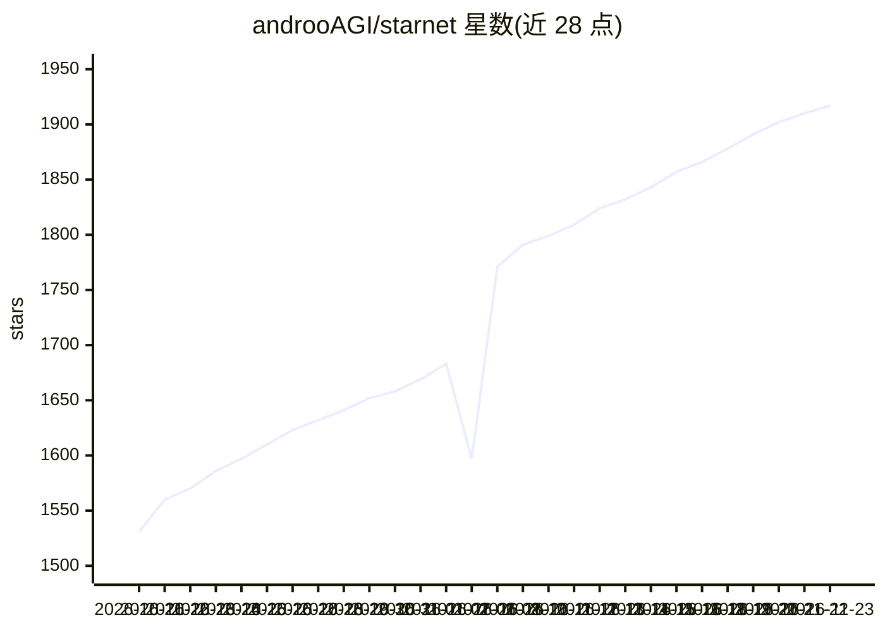

# androoAGI/starnet

⭐ 1,917 · JavaScript · MIT · 推送 2026-11-19 · [GitHub](https://github.com/androoAGI/starnet) · [官网](https://github.com/androoAGI/starnet-releases/releases/latest) · 个人维护

**本地优先的像素风桌面 agent 工作站，让多个 AI agent 执行真实任务**

基于 Tauri 的本地优先桌面应用：用户创建多个 AI agent 并布置到像素风空间站中，空间站是运行时状态的可视化投影——房间对应权限范围的团队、走廊对应授权交接通道、放置的物件对应真实能力授予。每个 agent 拥有独立工作区、转录、记忆与受限权限，模型调用与工具执行通过本地 Node sidecar 进行；密钥存于 OS keychain，支持 BYOK 或 OAuth 登录，支出与运行记录持久化到磁盘。Windows/macOS 提供安装包，Linux 无公开支持目标，macOS 覆盖较少。

## 筛选速览

| 维度 | 判定 | 备注 |
|---|---|---|
| AI 角色 | `ai-ecosystem` | LLM/agent 周边工具 |
| 许可风险 | `permissive` | MIT |
| 部署形态 | `desktop` | 安装包/桌面程序 |
| 模型依赖 | local-ok | 支持本地模型 |
| 硬件要求 | — | 无带数字的原话,不猜 |
| 安装摩擦 | `low` | 无编译、无系统依赖或容器化 |
| 成熟度 | `idea` | |

## 能力要点

- 空间站布局即 agent 工作流，界面只断言运行时可证明的状态
- 多 agent 并发运行，各自独立工作区、记忆与受限权限
- BYOK 密钥存 OS keychain，支持 OpenRouter 密钥或 Anthropic/OpenAI/Google OAuth
- MCP 连接器、cron 调度、Telegram/Discord/Slack/Signal/Matrix 远程消息与终端 CLI

## 适用场景

- 在自己的桌面上运行多个 AI agent 处理真实任务并监控开销
- 通过 Ollama 本地模型免费用 agent（需支持工具调用的模型）
- 把 agent 接到 Telegram/Discord 等渠道远程对话与审批
- 从 OpenClaw 或 Hermes 导入已有 agent 配置

## 场景标签

`多智能体` · 领域:Agent 开发

## 证据(README 行号)

> L18: StarNet is a local-first desktop harness where you create AI agents, organize them into a
> L47: - Model calls stream through the local Node sidecar.

## 星数曲线

2026-10-21 1,531 → 2026-11-23 1,917（+386）

---
*卡片 v1 · prompt 1.4 · 生成 2026-11-23 · 置信度 high · 依据 README sha `b73ae80b1bab` · [字段定义](../../DATASET.md)*
