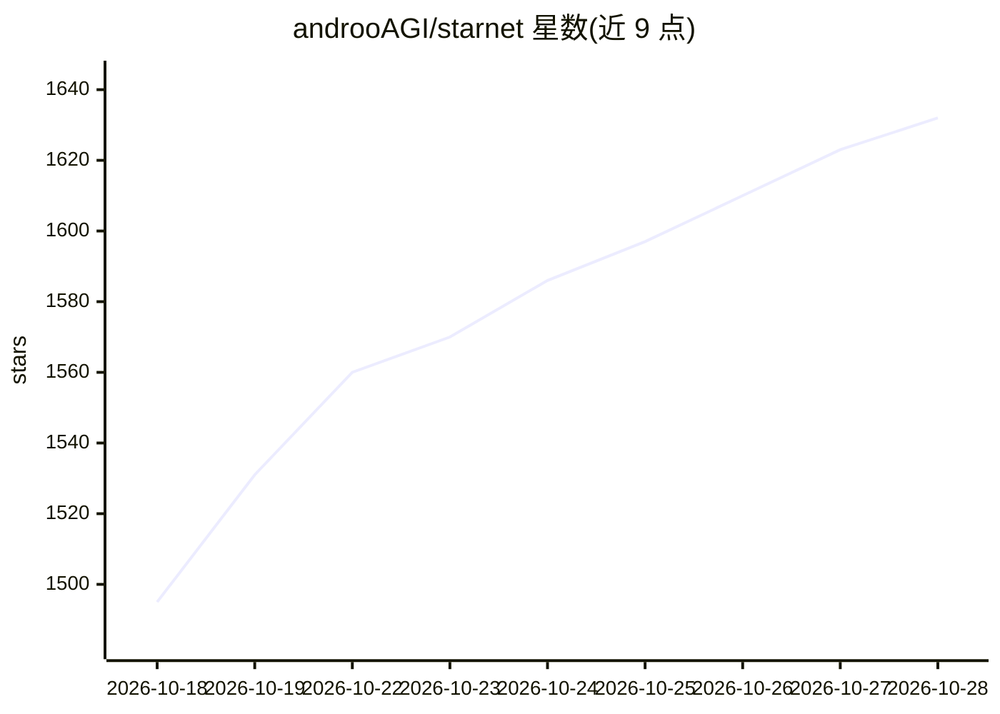

# androoAGI/starnet

⭐ 1,641 · JavaScript · MIT · 推送 2026-10-26 · [GitHub](https://github.com/androoAGI/starnet) · [官网](https://github.com/androoAGI/starnet-releases/releases/latest) · 个人维护

**像素风空间站界面的本地多 AI agent 桌面运行台（BYOK）**

基于 Tauri + 本地 Node sidecar 的桌面 agent 运行环境：用户创建具有独立类别人设、工作区、记忆与受限权限的多个 agent，并发放到像素风空间站界面上并发执行真实任务。空间布局本身映射运行时状态与权限授予。接入方式为 BYOK（OpenRouter 密钥或 Anthropic/OpenAI/Google OAuth），也可连接本地 Ollama 免费运行；支持 Telegram/Discord/Slack 等渠道远程对话、MCP 连接器、语音输入与定时任务。产物以文件形式落到 OUTBOX，账本与状态本地持久化。桌面安装包仅支持 Windows 与 macOS，Linux 包为内部构建产物。

## 筛选速览

| 维度 | 判定 | 备注 |
|---|---|---|
| AI 角色 | `ai-native` | 本体是模型或模型工具 |
| 许可风险 | `permissive` | MIT |
| 部署形态 | `desktop` | 安装包/桌面程序 |
| 模型依赖 | local-ok | 支持本地模型 |
| 硬件要求 | — | 无带数字的原话,不猜 |
| 安装摩擦 | `low` | 无编译、无系统依赖或容器化 |
| 成熟度 | `idea` | |

## 能力要点

- 多 agent 并发运行，各自独立工作区、记忆、转录与受限权限
- BYOK 接入 OpenRouter/Anthropic/OpenAI/Google，密钥存 OS 钥匙串
- 支持 Ollama 本地模型无密钥运行（127.0.0.1:11434）
- 像素空间站界面投影真实运行时状态，界面不得断言无法证明的状态

## 适用场景

- 在本地搭建并观察多个 AI agent 并发执行真实任务
- 通过 Telegram/Discord/Slack 等渠道远程指挥 agent
- 不付云端费用，用 Ollama 本地模型运行 agent

## 场景标签

`Agent 框架` `多智能体` · 领域:Agent 开发

## 证据(README 行号)

> L18: StarNet is a local-first desktop harness where you create AI agents, organize them into a
> L19: pixel-art space station, and watch them perform real work with real models and tools. The
> L27: The harness performs **real model calls, real tools, real cost** rather than animating a

## 星数曲线

2026-10-18 1,495 → 2026-10-28 1,632（+137）

---
*卡片 v1 · prompt 1.4 · 生成 2026-10-21 · 置信度 high · 依据 README sha `dd8fbd5a77ac` · [字段定义](../../DATASET.md)*
