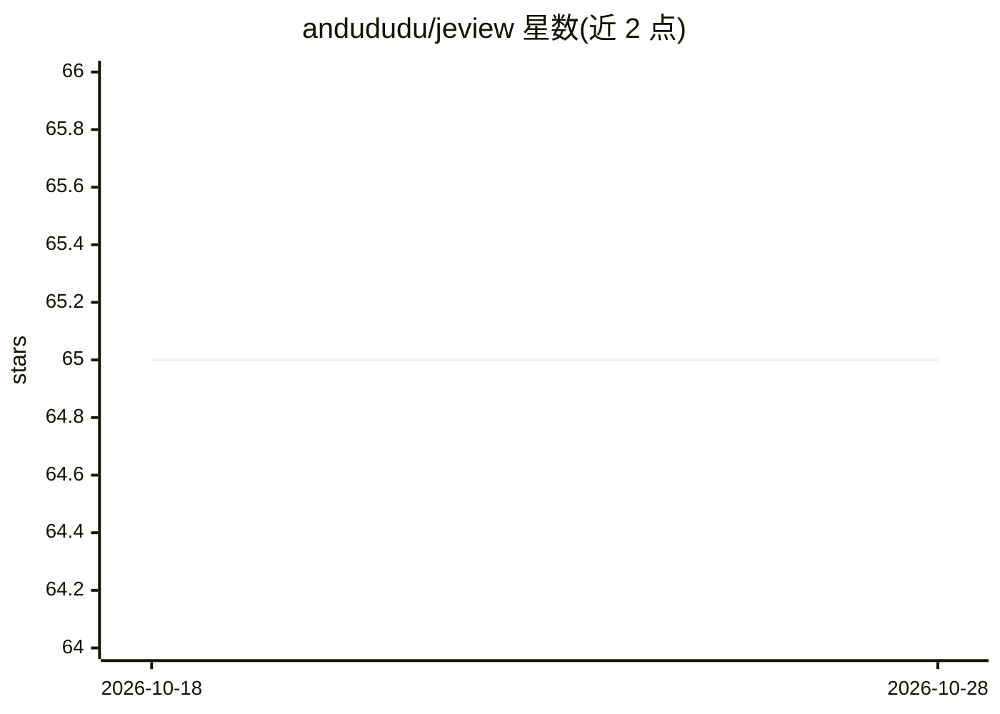

# andududu/jeview

⭐ 65 · JavaScript · MIT · 推送 2026-09-21 · [GitHub](https://github.com/andududu/jeview) · 个人维护

**Jev (TypeSafe) API 调用的本地网关与实时可视化工具**

位于用户代码与 TypeSafe (api.typesafe.ai) 之间的本地代理网关：把请求转发给 Jev 并将应答返回，同时把每次调用记录到本地 SQLite 数据库，并在实时界面上以图形式展示调用链。支持按项目路径分组请求、通过 Jeview-Trigger 头关联后续请求形成调用图、llms.txt 供 agent 读取。仅监听 127.0.0.1、无登录；API key 以明文存储于 jeview.sqlite。需 Node 24+，无其他依赖，非 TypeSafe AI 官方项目。

## 筛选速览

| 维度 | 判定 | 备注 |
|---|---|---|
| AI 角色 | `ai-ecosystem` | LLM/agent 周边工具 |
| 许可风险 | `permissive` | MIT |
| 部署形态 | `library` | 以包/库形式分发 |
| 模型依赖 | — | README 未给出锁定关系 |
| 硬件要求 | — | 无带数字的原话,不猜 |
| 安装摩擦 | `low` | 无编译、无系统依赖或容器化 |
| 成熟度 | — | 结构信号不足 |

## 能力要点

- 网关模式：代理 Jev 请求并把每次调用存入本地 SQLite
- 调用实时地图展示，支持 Jeview-Trigger 头将后续请求挂到先前答案上形成链路
- Jeview-Display 头自定义地图上答案的显示字段
- 为 agent 提供 llms.txt 描述自身地址与 key 状态

## 适用场景

- 观察我的代码对 Jev 的每次调用并追踪调用链
- 按项目/标签分组查看 API 调用历史
- 本地记录与检索长历史调用（打开最近 2 万条，搜索覆盖其余）

## 场景标签

`LLM 可观测性` · 领域:评测与运维

## 证据(README 行号)

> L12: Jeview is a gateway: it sits between your code and TypeSafe and answers nothing itself. Point your Jev client at
> L13: Jeview instead of TypeSafe. Jeview sends each request on to Jev with your key, hands Jev's answer back, keeps every

## 星数曲线

2026-10-18 65 → 2026-10-28 65（+0）

---
*卡片 v1 · prompt 1.4 · 生成 2026-10-24 · 置信度 mid · 依据 README sha `9b1c21c89f45` · [字段定义](../../DATASET.md)*
