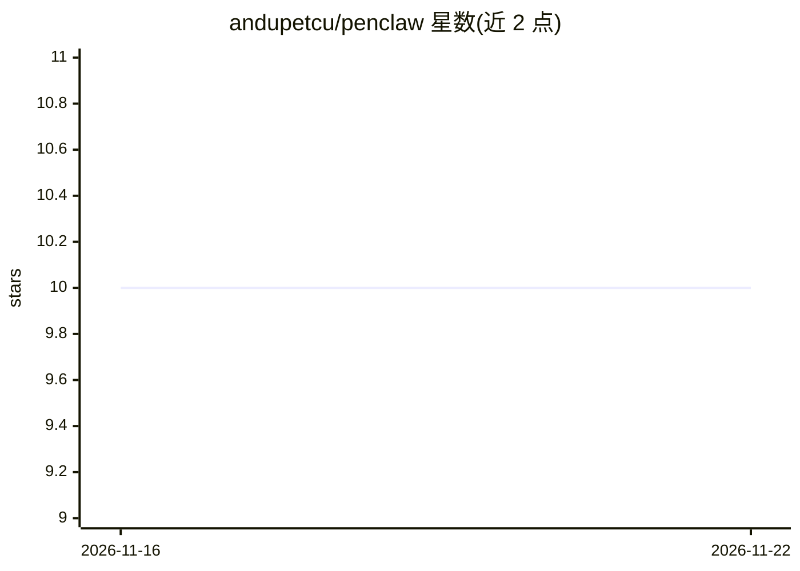

# andupetcu/penclaw

⭐ 10 · TypeScript · MIT · 推送 2026-07-27 · [GitHub](https://github.com/andupetcu/penclaw) · 个人维护

**AI 辅助分诊的渗透测试 CLI，扫描源码与线上站点并产出报告**

面向安全测试场景的命令行工具：对源码目录或线上 URL 执行静态分析（Trivy、Semgrep、密钥检测）与动态扫描（Nuclei 模板、Playwright 爬取、SQLi/XSS/JWT/IDOR 注入测试、OWASP Top 10 检查）。AI 用于分诊环节，为发现项生成推理、PoC 与修复建议；严重度与置信度由工具自身确定性计算。JWT 与 IDOR 需对目标主动验证后才按高严重度上报。支持 Markdown/JSON/SARIF/HTML 报告与 CI 模式。

## 筛选速览

| 维度 | 判定 | 备注 |
|---|---|---|
| AI 角色 | `ai-enhanced` | 去掉 AI 部分产品仍成立 |
| 许可风险 | `permissive` | MIT |
| 部署形态 | `library` | 以包/库形式分发 |
| 模型依赖 | local-ok | 支持本地模型 |
| 硬件要求 | — | 无带数字的原话,不猜 |
| 安装摩擦 | `low` | 无编译、无系统依赖或容器化 |
| 成熟度 | — | 结构信号不足 |

## 能力要点

- 静态+动态扫描：Trivy、Semgrep、Nuclei 5,600+ 模板、Playwright 爬取
- AI triage 生成推理、PoC 与修复建议，支持 Anthropic/OpenAI/Ollama 多后端
- JWT/IDOR 发现需主动确认后才按 high/critical 上报
- 输出 Markdown/JSON/SARIF/HTML 四种格式并支持 CI 门禁

## 适用场景

- 对 Node.js 项目源码做安全扫描并生成 PR 可用的报告
- 对 staging 环境做完整渗透测试
- 在 GitHub Actions 中按严重度拦截构建

## 场景标签

`网络安全` · 领域:学习与行业

## 证据(README 行号)

> L3: **AI-powered penetration testing CLI.** One command → real pentest report with only proven, exploitable findings.
> L26: - Multi-provider: **Anthropic Claude**, **OpenAI GPT**, **Ollama** (local models)
> L30: > Severity, confidence, and false-positive likelihood are computed **deterministically** by PenClaw — not by the mo

## 星数曲线

2026-11-16 10 → 2026-11-22 10（+0）

---
*卡片 v1 · prompt 1.4 · 生成 2026-11-20 · 置信度 mid · 依据 README sha `ebf3ec21fac1` · [字段定义](../../DATASET.md)*
