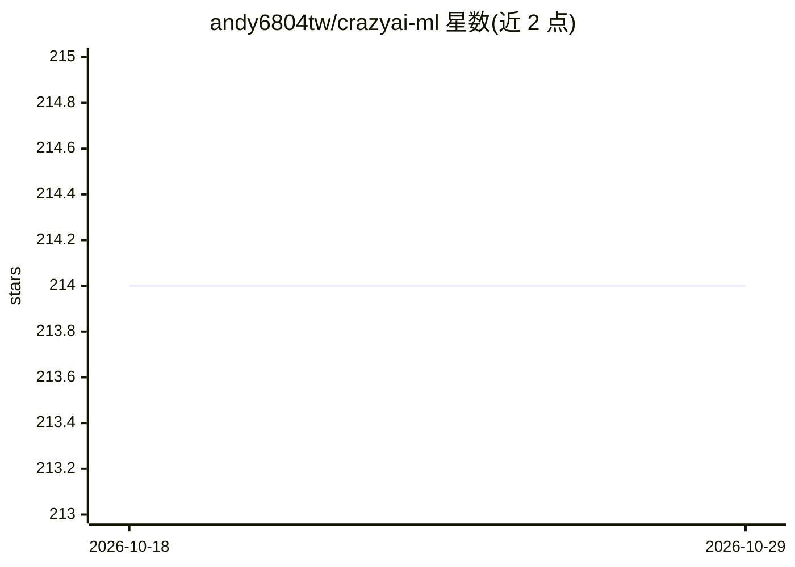

# andy6804tw/crazyai-ml

⭐ 214 · CSS · 推送 2026-01-19 · [GitHub](https://github.com/andy6804tw/crazyai-ml) · [官网](https://andy6804tw.github.io/crazyai-ml/) · 个人维护 · 中文 README

**面向初学者的中文经典机器学习系列教程与免费电子书**

由作者 10程式中的10（andy6804tw）维护的机器学习教學内容库：以 iT邦幫忙鐵人賽 30 天系列文章为主体，覆盖资料预处理、K-means、KNN、SVM、决策树、随机森林、XGBoost/LightGBM/CatBoost、AutoML、超参数调优、交叉验证，以及用 Flask 架设 API 并部署到 Heroku 的模型落地流程，多数主题附 notebook 程式码。该系列已出版实体书（含勘误 Wiki），并另有可解释 AI、深度学习等系列。示例程式通过 Google Colab 云端运行，无需本地安装。

## 筛选速览

| 维度 | 判定 | 备注 |
|---|---|---|
| AI 角色 | `ai-knowledge` | 知识聚合/清单类 |
| 许可风险 | `none` | — |
| 部署形态 | `None` |  |
| 模型依赖 | — | README 未给出锁定关系 |
| 硬件要求 | — | 无带数字的原话,不猜 |
| 安装摩擦 | `low` | 无编译、无系统依赖或容器化 |
| 成熟度 | — | 结构信号不足 |

## 能力要点

- 30 天系列覆盖经典机器学习演算法与模型部署（Flask/Heroku）
- 多数篇章附配套 notebook 程式码，经 Google Colab 运行
- 已出版实体书（十三种实务范例），提供勘误与更新 Wiki
- 另含 XAI、深度学习、强化学习、LLM 应用等系列规划

## 适用场景

- 零基础读者系统学习经典机器学习演算法与实作
- 跟做模型训练、调参与部署 API 的完整流程
- 查阅 XGBoost/LightGBM/AutoML 等套件的手把手范例

## 场景标签

`教程课程` · 领域:学习与行业

## 证据(README 行号)

> L80: ## 全民瘋AI系列電子書 (免費開源版)
> L95: |[[Day 1] 全民瘋AI系列2.0-機器學習實戰手冊](https://ithelp.ithome.com.tw/articles/10263409)|-|

## 星数曲线

2026-10-18 214 → 2026-10-29 214（+0）

---
*卡片 v1 · prompt 1.4 · 生成 2026-10-22 · 置信度 high · 依据 README sha `fd3d3f925537` · [字段定义](../../DATASET.md)*
