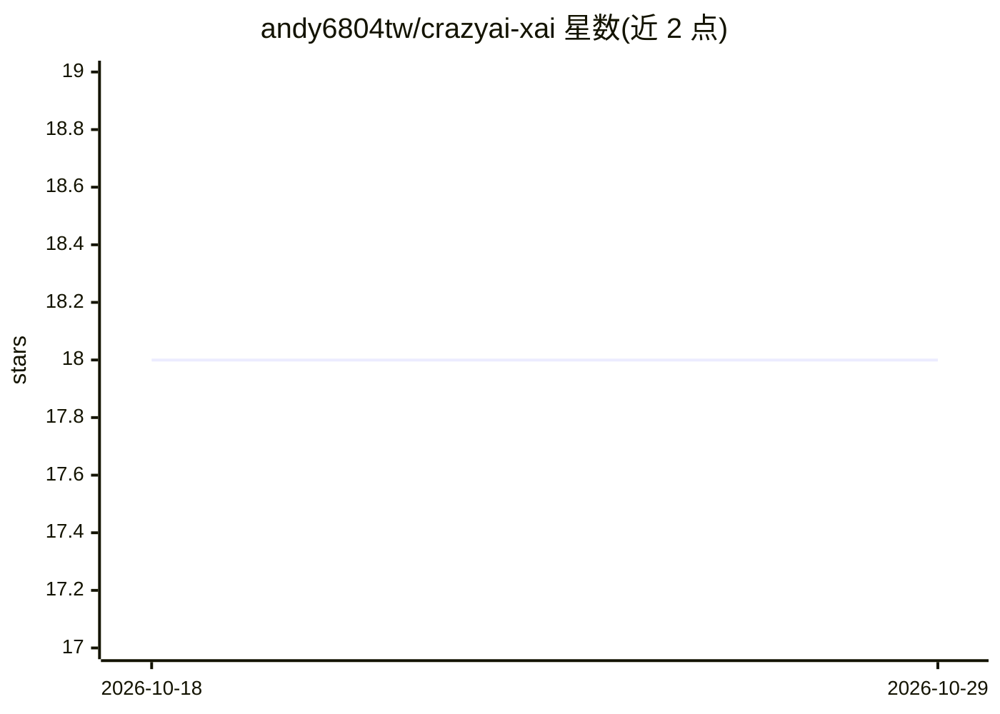

# andy6804tw/crazyai-xai

⭐ 18 · Jupyter Notebook · 推送 2025-11-23 · [GitHub](https://github.com/andy6804tw/crazyai-xai) · [官网](https://andy6804tw.github.io/crazyai-xai/) · 个人维护 · 中文 README

**可解释AI（XAI）30天系列教程与配套代码**

第15届iT邦帮忙铁人赛系列文章仓库：以30篇文章系统介绍可解释人工智能（XAI），涵盖可解释性指标、Permutation Importance、PDP、LIME、SHAP 等方法，以及神经网络解释（Deep SHAP、梯度、CAM、Attention）与影像瑕疵检测、表格数据、NLP 情感分析等应用案例；部分主题附 Colab/Jupyter 配套代码。提供 GitHub Pages 电子书与 PDF 版本，面向希望理解与应用 XAI 的机器学习读者。

## 筛选速览

| 维度 | 判定 | 备注 |
|---|---|---|
| AI 角色 | `ai-knowledge` | 知识聚合/清单类 |
| 许可风险 | `none` | — |
| 部署形态 | `None` |  |
| 模型依赖 | — | README 未给出锁定关系 |
| 硬件要求 | — | 无带数字的原话,不猜 |
| 安装摩擦 | `low` | 无编译、无系统依赖或容器化 |
| 成熟度 | — | 结构信号不足 |

## 能力要点

- 30 篇 XAI 主题文章，涵盖 LIME、SHAP、Permutation Importance 等解释方法
- 多篇附 Colab/Jupyter 配套代码（约 15 篇标注 Code）
- 提供 GitHub Pages 电子书与 PDF 版本
- 包含影像瑕疵检测、智慧工厂钢材缺陷、NLP 情感分析等应用案例

## 适用场景

- 系统学习可解释机器学习的主流方法
- 跟着 Colab 代码实践 SHAP、LIME 等解释技术
- 查找 XAI 在影像、表格、NLP 场景的应用案例

## 场景标签

`教程课程` · 领域:学习与行业

## 证据(README 行号)

> L16: 本系列將從 XAI 的基礎知識出發，深入探討可解釋人工智慧在機器學習和深度學習中的應用、案例和挑戰，以及未來發展方向。希望透過這個系列，幫助讀者更好地理解和應用可解釋人工智慧技術，促進可信、透明、負責任的人工智慧發展。
> L20: |文章|程式|

## 星数曲线

2026-10-18 18 → 2026-10-29 18（+0）

---
*卡片 v1 · prompt 1.4 · 生成 2026-10-29 · 置信度 high · 依据 README sha `2effa0ecd2db` · [字段定义](../../DATASET.md)*
