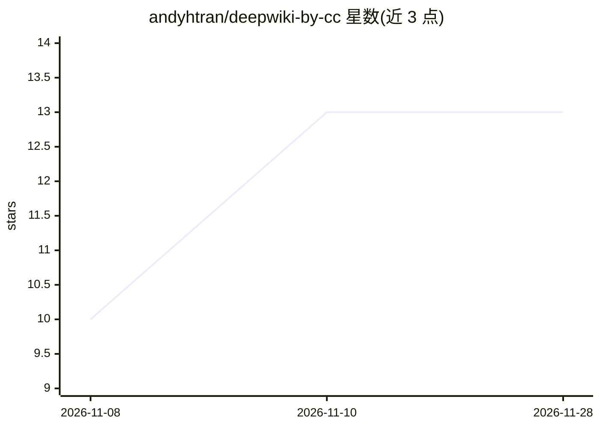

# andyhtran/deepwiki-by-cc

⭐ 13 · TypeScript · MIT · 推送 2026-07-13 · [GitHub](https://github.com/andyhtran/deepwiki-by-cc) · 个人维护

**自托管代码库 Wiki 生成器：为任意仓库产出可浏览文档**

自托管的开源 DeepWiki 替代实现：输入 GitHub 仓库或本地目录后，克隆并扫描源码（遵循 .gitignore 过滤二进制与生成代码）、用所选模型生成结构化大纲，再由带只读工具（read/grep/glob）的 agent 逐页探索代码后撰写页面，结果以带 Mermaid 图、侧边栏导航的 SvelteKit 站点呈现，存于 SQLite。支持按 diff 同步更新、中断续跑、多版本管理，内置评测工具。依赖 Bun 运行时与 Claude CLI / Codex CLI 认证。

## 筛选速览

| 维度 | 判定 | 备注 |
|---|---|---|
| AI 角色 | `ai-native` | 本体是模型或模型工具 |
| 许可风险 | `permissive` | MIT |
| 部署形态 | `self-host` | docker 或自建部署 |
| 模型依赖 | locked-api |  |
| 硬件要求 | — | 无带数字的原话,不猜 |
| 安装摩擦 | `low` | 无编译、无系统依赖或容器化 |
| 成熟度 | — | 结构信号不足 |

## 能力要点

- 逐页由 agent 在仓库检出内探索代码后撰写，使用只读工具
- 按 diff 选择受影响页面做增量更新，支持中断续跑与多版本
- 内置评测框架：确定性指标 + LLM 判分 QA 与成对比较
- Docker 一键自托管，经 GH_TOKEN 支持私有仓库

## 适用场景

- 为团队不熟悉的 GitHub 仓库生成交织代码引用的 Wiki
- 为本地代码库建立带导航与架构图的文档站点
- 仓库更新后仅重新生成受影响页面保持文档同步

## 场景标签

 · 领域:开发者工具/文档生成

## 证据(README 行号)

> L3: Generate comprehensive, navigable wikis for any GitHub repository or local codebase using Claude or Codex.
> L17: - **Agentic page generation** — each page is written by an agent running inside the repo checkout with read-only to

## 星数曲线

2026-11-08 10 → 2026-11-28 13（+3）

---
*卡片 v1 · prompt 1.4 · 生成 2026-11-18 · 置信度 high · 依据 README sha `887fc3a85b5f` · [字段定义](../../DATASET.md)*
