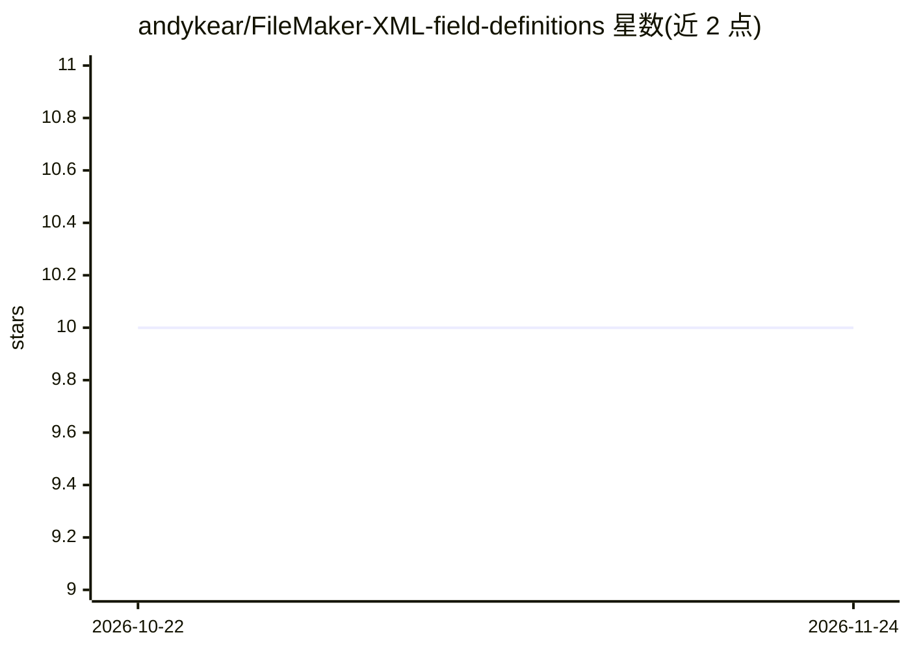

# andykear/FileMaker-XML-field-definitions

⭐ 10 · CC-BY-4.0 · 推送 2026-11-18 · [GitHub](https://github.com/andykear/FileMaker-XML-field-definitions) · [官网](https://clockworkct.co.uk) · 组织维护

**FileMaker 逆向 XML schema 规范，打包为 Claude Skill**

对 FileMaker 未公开的字段/表/值列表定义 XML 粘贴格式做逆向工程整理：通过生成—粘贴—导出—比对的往返测试，记录元素顺序约束、命名冲突行为、引用解析规则与静默失败模式。以 Claude Skill 形式打包，每个 catalog 一个参考文件以控制 token 用量；参考文件为纯 markdown，可被其他 LLM 或人类阅读。安装需下载 release zip 载入 Claude 技能目录，且需启用代码执行与文件创建；粘贴入 FileMaker 依赖 MBS Plugin 写入私有剪贴板类型（XMFD/XMTB/XMVL）。许可证 CC BY 4.0。

## 筛选速览

| 维度 | 判定 | 备注 |
|---|---|---|
| AI 角色 | `ai-knowledge` | 知识聚合/清单类 |
| 许可风险 | `viral` | CC-BY-4.0 |
| 部署形态 | `None` |  |
| 模型依赖 | — | README 未给出锁定关系 |
| 硬件要求 | — | 无带数字的原话,不猜 |
| 安装摩擦 | `low` | 无编译、无系统依赖或容器化 |
| 成熟度 | — | 结构信号不足 |

## 能力要点

- 覆盖字段、表、值列表三个 catalog 的粘贴格式规范
- 通过往返测试验证而非推断，含 FileMaker 26.1 计算 value list
- 按 catalog 拆分参考文件以控制 token 使用
- 声明模型无关：参考文件为纯 markdown，可集成到其他生成工具

## 适用场景

- 让 LLM 生成可安全粘贴进 FileMaker 的 schema XML
- 审查现有 fmxmlsnippet 是否会触发粘贴处理的静默失败
- 构建生成 FileMaker schema XML 的工具时参考粘贴规则

## 场景标签

`提示工程` `代码生成` · 领域:Agent 开发

## 证据(README 行号)

> L6: Reverse-engineered specification of FileMaker's undocumented schema definition XML, across all three definition cata
> L34: Tested with Claude, and model-agnostic by design: the reference files are plain markdown, readable by any LLM or hu
> L38: Download the release zip and load it into Claude's skills. The zip contains the skill folder with SKILL.md and the 

## 星数曲线

2026-10-22 10 → 2026-11-24 10（+0）

---
*卡片 v1 · prompt 1.4 · 生成 2026-11-20 · 置信度 mid · 依据 README sha `a773c73bd382` · [字段定义](../../DATASET.md)*
