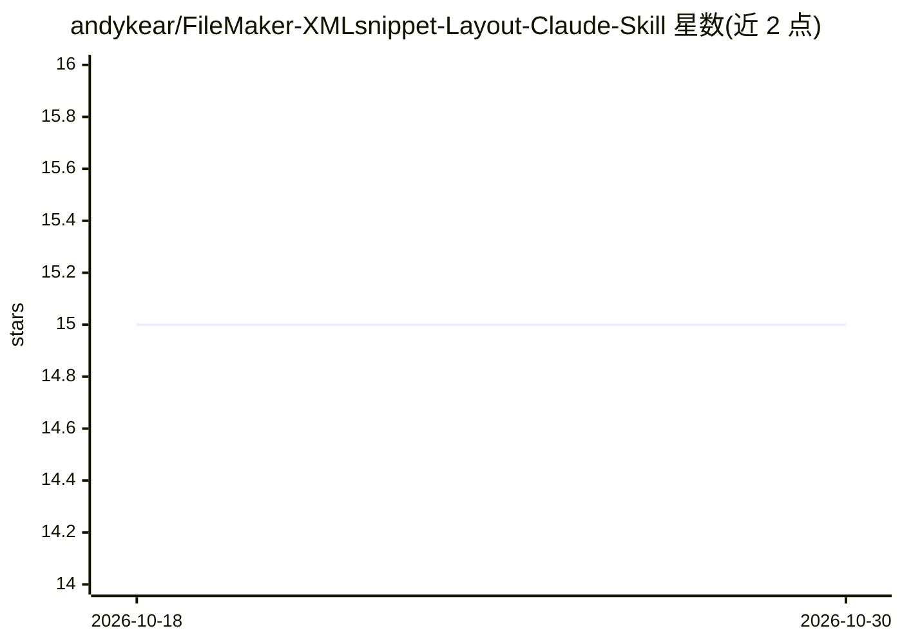

# andykear/FileMaker-XMLsnippet-Layout-Claude-Skill

⭐ 15 · CC-BY-4.0 · 推送 2026-10-03 · [GitHub](https://github.com/andykear/FileMaker-XMLsnippet-Layout-Claude-Skill) · [官网](https://clockworkct.co.uk) · 个人维护

**为 Claude 提供 FileMaker 布局 XML 格式逆向规范的技能包**

一个 Claude Skill，包含对 FileMaker 未公开的布局剪贴板 XML 格式（fmxmlsnippet LayoutObjectList）的逆向工程规范：覆盖全部 18 种布局对象类型、标志位解码与元素顺序规则，全部通过往返粘贴测试验证。规范以 SKILL.md 与约 1800 行参考文档形式提供，安装到 Claude 组织技能库后，用户可让 AI 生成可直接粘贴进 FileMaker 布局模式的 XML，或审查现有 XML。设计上模型无关，但仅在 Claude 上测试过；需 Claude Pro/Team/Enterprise 且组织启用 Skills。整布局重主题化功能仍在开发中，不建议用于生产布局。

## 筛选速览

| 维度 | 判定 | 备注 |
|---|---|---|
| AI 角色 | `ai-knowledge` | 知识聚合/清单类 |
| 许可风险 | `viral` | CC-BY-4.0 |
| 部署形态 | `desktop` | 安装包/桌面程序 |
| 模型依赖 | locked-api |  |
| 硬件要求 | — | 无带数字的原话,不猜 |
| 安装摩擦 | `low` | 无编译、无系统依赖或容器化 |
| 成熟度 | — | 结构信号不足 |

## 能力要点

- 覆盖全部 18 种布局对象类型的经验性逆向规范（往返测试验证）
- 识别并修复多对象 Text/Button 粘贴静默损坏问题（ExtendedAttributes 修复）
- 安装后 Claude 自动应用，可读取 DDR/Save as XML 导出中的真实 schema
- 许可为 CC BY 4.0，重用需署名

## 适用场景

- 让 Claude 生成可直接粘贴到 FileMaker 布局模式的布局 XML
- 审查现有 fmxmlsnippet XML 的粘贴处理错误
- 基于 DDR 导出的真实字段与关系名生成布局对象

## 场景标签

`代码生成` `代码审查` · 领域:编码与开发

## 证据(README 行号)

> L7: A Claude skill that gives AI models a deterministic, empirically verified foundation for generating and analysing Fi
> L40: SKILL.md                                   Claude skill definition
> L43:   filemaker_layout_xml_rules.md            Full specification (v2.5, ~1800 lines)

## 星数曲线

2026-10-18 15 → 2026-10-30 15（+0）

---
*卡片 v1 · prompt 1.4 · 生成 2026-10-30 · 置信度 high · 依据 README sha `3f25e4bd62a0` · [字段定义](../../DATASET.md)*
