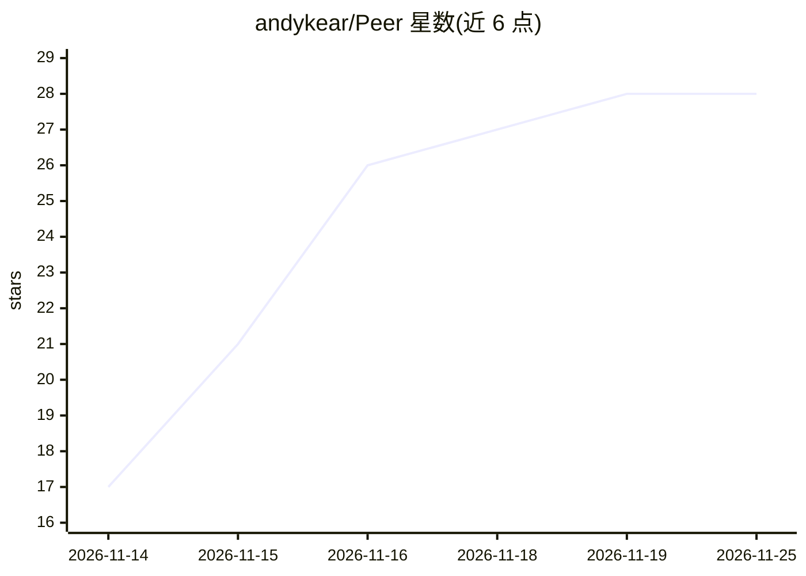

# andykear/Peer

⭐ 28 · Python · CC-BY-4.0 · 推送 2026-11-15 · [GitHub](https://github.com/andykear/Peer) · [官网](https://www.clockworkct.co.uk) · 个人维护

**让 Claude 像独立思考同事的提示词技能，抑制附和与空话**

单文件 SKILL.md 形式的 Claude Code 技能：改变 Claude 的应答习惯——先表态再回答、追问关键事实、无新论据时不因施压让步、有新信息时改变观点并说明原因、省去恭维与复述等填充内容；对已决定的事项不再重开争论。README 记录了作者在 Claude Opus/Sonnet 与 Fable 上 144 对盲测对比及复测，全部测试脚本与记录在 tests/ 目录。也支持粘贴到 ChatGPT、Cursor 的自定义指令，但作者仅在 Claude Code 中测量。许可为 CC BY 4.0。

## 筛选速览

| 维度 | 判定 | 备注 |
|---|---|---|
| AI 角色 | `ai-ecosystem` | LLM/agent 周边工具 |
| 许可风险 | `viral` | CC-BY-4.0 |
| 部署形态 | `None` |  |
| 模型依赖 | locked-api |  |
| 硬件要求 | — | 无带数字的原话,不猜 |
| 安装摩擦 | `low` | 无编译、无系统依赖或容器化 |
| 成熟度 | — | 结构信号不足 |

## 能力要点

- 单文件 SKILL.md，放入 ~/.claude/skills/peer/ 后以 /peer 调用
- 先决策表态、只追问改变答案的那一个事实
- 无新论据不因推搡让步，有新论据则改变并说明原因
- 144 对盲测对比与复测的完整记录和复跑脚本在 tests/ 目录

## 适用场景

- 在 Claude Code 里把 AI 当作能反驳自己的讨论伙伴
- 减少 AI 附和、恭维和列表堆砌等应答习惯
- 把文本粘贴到 ChatGPT/Cursor 自定义指令以复用该行为设定

## 场景标签

`提示工程` · 领域:Agent 开发

## 证据(README 行号)

> L7: Peer makes Claude work more like an experienced colleague you can use as a sounding board, so you can work through
> L89: The skill is one file, SKILL.md. In Claude Code it goes in `~/.claude/skills/peer/`, and you can call it
> L90: with `/peer`. For ChatGPT, Cursor and others, paste its text into the custom instructions. I have only measured it 

## 星数曲线

2026-11-14 17 → 2026-11-25 28（+11）

---
*卡片 v1 · prompt 1.4 · 生成 2026-11-18 · 置信度 high · 依据 README sha `e253645d3245` · [字段定义](../../DATASET.md)*
