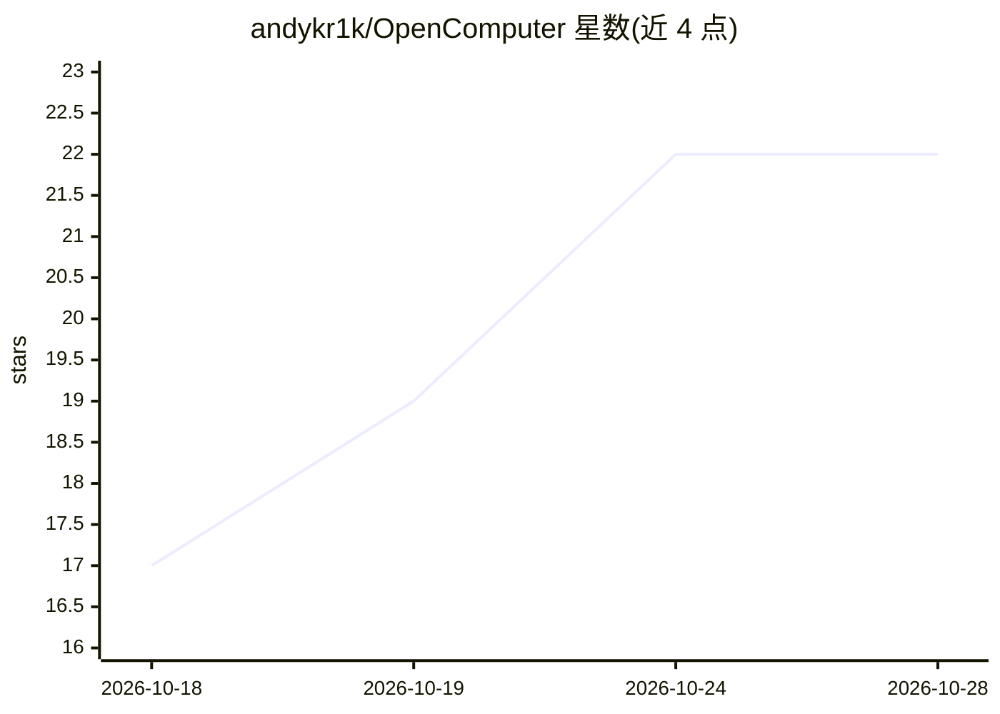

# andykr1k/OpenComputer

⭐ 22 · TypeScript · MIT · 推送 2026-10-01 · [GitHub](https://github.com/andykr1k/OpenComputer) · 个人维护

**本地优先的开源 computer-use 桌面操作 Agent**

跨 Linux/Windows/macOS 的 Electron 桌面应用：以悬浮球加聊天面板形态，截屏理解屏幕内容，通过鼠标移动、点击、拖拽、滚动、键盘输入等基础人机交互操作普通桌面应用。默认接入本地 vLLM 服务运行 RedHatAI/Qwen3.5-9B 量化视觉语言模型（面向 16GB GPU），也支持任意 OpenAI 兼容 API 端点。提供 Ask first 逐步审批与 Automatic 两种权限模式、25 步默认限制与可中断机制；项目自述为早期 alpha，macOS/Windows 支持为实验性，仅操作主显示器。

## 筛选速览

| 维度 | 判定 | 备注 |
|---|---|---|
| AI 角色 | `ai-native` | 本体是模型或模型工具 |
| 许可风险 | `permissive` | MIT |
| 部署形态 | `library` | 以包/库形式分发 |
| 模型依赖 | local-ok | 支持本地模型 |
| 硬件要求 | — | 无带数字的原话,不猜 |
| 安装摩擦 | `low` | 无编译、无系统依赖或容器化 |
| 成熟度 | `idea` | |

## 能力要点

- 截屏驱动的多模态 Agent 循环，操作普通桌面应用而非浏览器专用 API
- 默认本地 vLLM 运行 Qwen3.5-9B 量化 VLM（面向 16GB GPU），也支持 OpenAI 兼容 API
- Ask first 逐步审批 / Automatic 两种权限模式，动作可中断
- 渲染进程无 Node.js 访问，凭据与自动化留在主进程

## 适用场景

- 用自然语言让本机模型代为操作桌面应用
- 在数据不出本机的前提下做屏幕理解与桌面自动化
- 通过逐步审批控制 Agent 的鼠标键盘操作

## 场景标签

`GUI 自动化` `AI 助手` · 领域:效率与自动化

## 证据(README 行号)

> L7: OpenComputer is an open-source, local-first computer-use agent for Linux, Windows, and macOS. It lives in a small de
> L9: Run it privately with a local vision-language model through vLLM, or connect any compatible hosted API. The default 
> L26: - Automatic desktop screenshot at the start of every request.
> L29: - Mouse movement, left/right/middle/double click, drag, and horizontal/vertical scrolling.

## 星数曲线

2026-10-18 17 → 2026-10-28 22（+5）

---
*卡片 v1 · prompt 1.4 · 生成 2026-10-27 · 置信度 high · 依据 README sha `5971e0b2f478` · [字段定义](../../DATASET.md)*
