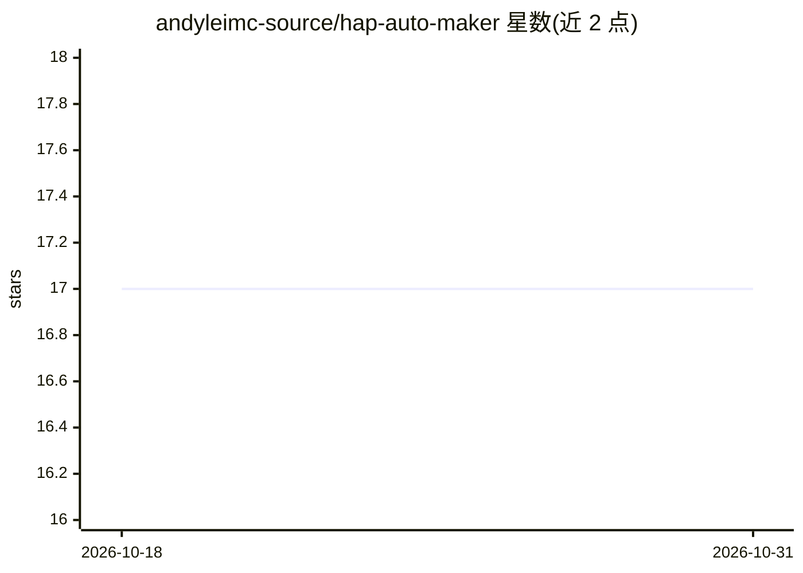

# andyleimc-source/hap-auto-maker

⭐ 17 · Python · 推送 2026-05-08 · [GitHub](https://github.com/andyleimc-source/hap-auto-maker) · [官网](https://www.mingdao.com) · 个人维护 · 中文 README

**自然语言驱动的明道云 HAP 应用自动搭建工具**

通过多模型 AI（Gemini/DeepSeek/MiniMax/Kimi/智谱 GLM/豆包/千问）+ 明道云 OpenAPI，从自然语言需求自动完成创建应用、工作表字段、视图、统计图表页、智能机器人到 Mock 数据的完整链路，多步骤以 Wave 并行调度执行。支持 38 种字段类型、11 种视图、17 种图表的 Schema 约束规划，并对已有应用做增量操作。需 macOS/Linux、Python 3.11/3.12 与明道云组织管理员账号；依赖公开 API 与部分浏览器接口抓包，前端接口变动可能导致功能需重新调试。

## 筛选速览

| 维度 | 判定 | 备注 |
|---|---|---|
| AI 角色 | `ai-native` | 本体是模型或模型工具 |
| 许可风险 | `none` | — |
| 部署形态 | `None` |  |
| 模型依赖 | locked-api |  |
| 硬件要求 | — | 无带数字的原话,不猜 |
| 安装摩擦 | `low` | 无编译、无系统依赖或容器化 |
| 成熟度 | — | 结构信号不足 |

## 能力要点

- 自然语言需求→应用上线的多步骤并行流水线
- 38 种字段类型、11 种视图类型、17 种图表类型的 Schema 约束规划
- 对已有应用支持增量添加工作表、字段、视图
- Mock 数据按字段类型智能生成

## 适用场景

- 用一句需求描述自动生成明道云 HAP 应用
- 为已有应用增量补充工作表、字段与报表
- 自动生成带语境的测试数据填充工作表

## 场景标签

`代码生成` `工作流自动化` · 领域:效率与自动化

## 证据(README 行号)

> L3: 基于多模型 AI（Gemini / DeepSeek / MiniMax / Kimi / 智谱 GLM / 豆包 / 千问）+ HAP 的自动化应用搭建引擎。
> L4: 通过自然语言描述需求，全自动完成从建表到上线的完整链路：**创建应用 → 工作表与字段 → 视图与筛选 → 统计图表页 → 智能机器人 → Mock 数据**，多步骤流水线并行执行，零人工干预。

## 星数曲线

2026-10-18 17 → 2026-10-31 17（+0）

---
*卡片 v1 · prompt 1.4 · 生成 2026-10-29 · 置信度 high · 依据 README sha `461fee07554a` · [字段定义](../../DATASET.md)*
