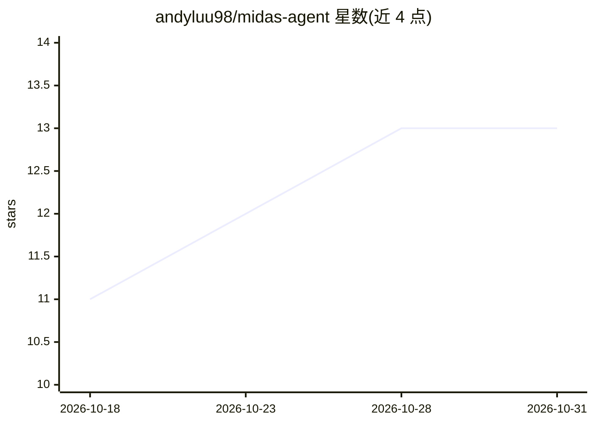

# andyluu98/midas-agent

⭐ 13 · Python · Apache-2.0 · 推送 2026-05-14 · [GitHub](https://github.com/andyluu98/midas-agent) · 个人维护

**面向 XAUUSD M15 剥头皮的多智能体 AI 交易决策框架**

TauricResearch/TradingAgents（MIT）的定制 fork，用 LangGraph 构建 8 个 agent 四层架构：4 个并行分析师（宏观/情绪/新闻/技术）→ 多头空头辩论 → 交易员 → 3 个风险辩论者加组合经理给出 Entry/SL/TP。主 LLM 为 DeepSeek，搜索后端按 Tavily→Anthropic→Claude/Gemini CLI 自动回退。附 ultimate_gold_hunter.py 脚本，结合 Kronos ML 多时间框架预测、SL 上限 10 pip、Cent 账户仓位计算与交易记忆自学习。README 声明输出仅为参考信号而非投资建议，要求先模拟盘两周。

## 筛选速览

| 维度 | 判定 | 备注 |
|---|---|---|
| AI 角色 | `ai-native` | 本体是模型或模型工具 |
| 许可风险 | `permissive` | Apache-2.0 |
| 部署形态 | `None` |  |
| 模型依赖 | locked-api |  |
| 硬件要求 | — | 无带数字的原话,不猜 |
| 安装摩擦 | `low` | 无编译、无系统依赖或容器化 |
| 成熟度 | — | 结构信号不足 |

## 能力要点

- 8 agent 四层架构（分析/辩论/交易/风险）输出 Entry/SL/TP
- Kronos ML 预测 H1/M15/M5 多时间框架交叉确认，M15 中性即跳过
- Search backend 自动回退链（Tavily/Anthropic/Claude CLI/Gemini CLI）防编造新闻
- 交易记忆写入本地文件供后续会话学习，支持 --checkpoint 断点恢复

## 适用场景

- 跑 XAUUSD M15 剥头皮的参考信号生成
- 通过交互式 CLI 分析其他 ticker
- 在模拟盘上研究多 agent 辩论式交易决策流程

## 场景标签

`金融量化` `多智能体` · 领域:Agent 开发

## 证据(README 行号)

> L3: **Midas Agent** dựng một "phòng họp 8 chuyên gia AI" trong máy bạn, chuyên trade vàng (XAUUSD) khung M15 trên MT5 Ex
> L30: **Tầng 2 — Tranh luận (2 vòng debate)**
> L37: - 3 Risk Debator (hung hăng / thận trọng / trung lập) → **Portfolio Manager** gõ búa cuối

## 星数曲线

2026-10-18 11 → 2026-10-31 13（+2）

---
*卡片 v1 · prompt 1.4 · 生成 2026-10-31 · 置信度 high · 依据 README sha `cacc0c72fc5d` · [字段定义](../../DATASET.md)*
