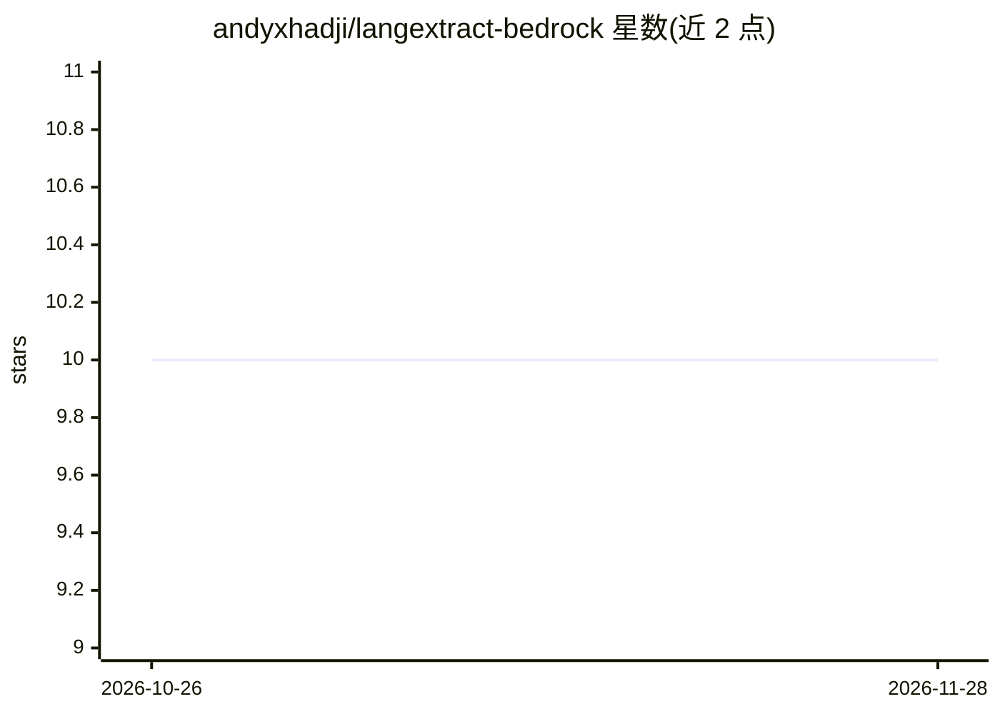

# andyxhadji/langextract-bedrock

⭐ 10 · Python · NOASSERTION · 推送 2026-05-22 · [GitHub](https://github.com/andyxhadji/langextract-bedrock) · [官网](https://pypi.org/project/langextract-bedrock/) · 个人维护

**为 LangExtract 提供接入 AWS Bedrock 模型的插件**

LangExtract 的 provider 插件包，用于通过 AWS Bedrock 调用模型完成文本抽取：以模型 ARN 指定任意 Bedrock 模型，经 factory.ModelConfig 创建模型，或在 lx.extract 中为模型 ID 加 `bedrock/` 前缀使用；凭据通过 AWS_PROFILE 或 AWS_ACCESS_KEY_ID/SECRET 环境变量配置，区域默认 us-east-1。以 pip 包分发，Apache 2.0 许可，README 含开发模式安装、pytest 测试与构建发布说明。

## 筛选速览

| 维度 | 判定 | 备注 |
|---|---|---|
| AI 角色 | `ai-ecosystem` | LLM/agent 周边工具 |
| 许可风险 | `none` | NOASSERTION |
| 部署形态 | `library` | 以包/库形式分发 |
| 模型依赖 | locked-api |  |
| 硬件要求 | — | 无带数字的原话,不猜 |
| 安装摩擦 | `low` | 无编译、无系统依赖或容器化 |
| 成熟度 | — | 结构信号不足 |

## 能力要点

- 通过模型 ARN 接入任意 AWS Bedrock 模型
- 与 lx.extract 集成，模型 ID 加 bedrock/ 前缀即可调用
- 支持 AWS_PROFILE 与密钥对两种凭据配置方式

## 适用场景

- 在 LangExtract 抽取流程中使用 Bedrock 上的模型（如 Claude）
- 为现有 LangExtract 项目扩展 Bedrock 模型接入

## 场景标签

 · 领域:LLM 基础设施/模型接入

## 证据(README 行号)

> L3: A provider plugin for LangExtract that supports AWS Bedrock models.
> L34: Use with `lx.extract` by pre-pending the model ARN with `bedrock/`:

## 星数曲线

2026-10-26 10 → 2026-11-28 10（+0）

---
*卡片 v1 · prompt 1.4 · 生成 2026-11-20 · 置信度 high · 依据 README sha `8f152965eb4e` · [字段定义](../../DATASET.md)*
