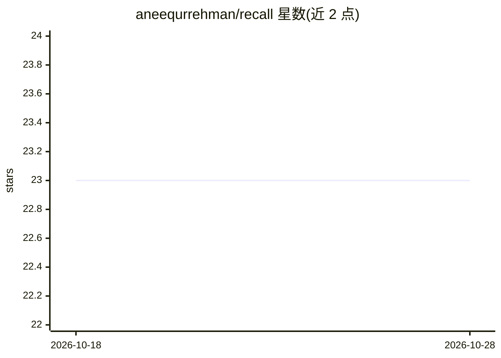

# aneequrrehman/recall

⭐ 23 · TypeScript · MIT · 推送 2026-03-23 · [GitHub](https://github.com/aneequrrehman/recall) · [官网](https://recall-docs-sand.vercel.app) · 个人维护

**给 AI 应用加持久记忆的 TypeScript 组合式库**

以可组合包形式为 AI 应用提供持久记忆层：LLM 抽取对话事实，两步流程（抽取+合并）以 ADD/UPDATE/DELETE/NONE 决策去重记忆，支持向量相似搜索与基于 Zod schema 的 SQL 结构化记忆查询。数据存于用户自有数据库（SQLite/Postgres/MySQL），嵌入与抽取提供 OpenAI/Cohere/Voyage 等适配包，并有 Vercel AI SDK 与 MCP 集成。README 声明项目不再积极维护，仅为概念验证。pnpm/npm 安装。

## 筛选速览

| 维度 | 判定 | 备注 |
|---|---|---|
| AI 角色 | `ai-ecosystem` | LLM/agent 周边工具 |
| 许可风险 | `permissive` | MIT |
| 部署形态 | `library` | 以包/库形式分发 |
| 模型依赖 | — | README 未给出锁定关系 |
| 硬件要求 | — | 无带数字的原话,不猜 |
| 安装摩擦 | `low` | 无编译、无系统依赖或容器化 |
| 成熟度 | `idea` | |

## 能力要点

- 两步 LLM 流程（抽取+合并）自动去重记忆
- Core Memory 向量搜索 + Structured Memory Zod schema SQL 查询两种模式
- 数据库/嵌入/抽取器均为可插拔适配包，数据留在自有基础设施
- 提供 Vercel AI SDK 集成与独立 MCP server（适配 Claude、Cursor 等）

## 适用场景

- 为聊天机器人或 agent 添加跨会话的用户记忆
- 在已有数据库和工作流（Inngest、Vercel WDK）中做后台记忆抽取
- 以结构化 schema 精确记录并查询支付、健身、用药等数据

## 场景标签

`Agent 记忆` · 领域:Agent 开发

## 证据(README 行号)

> L7: Composable building blocks for adding persistent memory to AI applications.
> L62: - **LLM-powered extraction** — Automatically extract facts from conversations
> L65: - **Pluggable architecture** — Swap databases, embedding providers, and extractors

## 星数曲线

2026-10-18 23 → 2026-10-28 23（+0）

---
*卡片 v1 · prompt 1.4 · 生成 2026-10-27 · 置信度 high · 依据 README sha `ab01a283b90e` · [字段定义](../../DATASET.md)*
