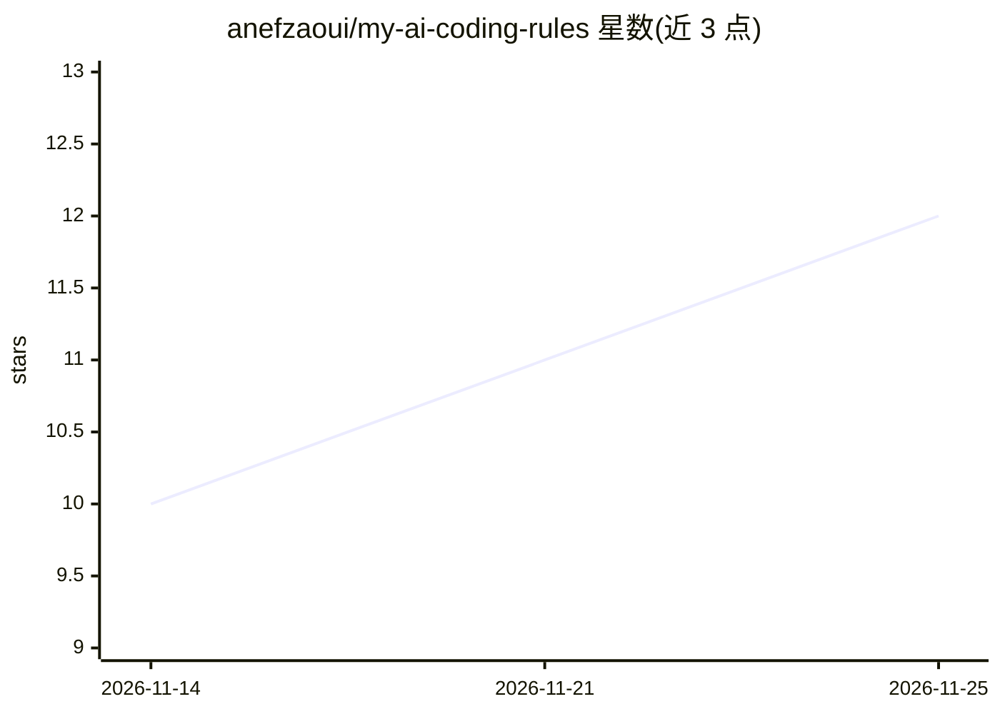

# anefzaoui/my-ai-coding-rules

⭐ 12 · 推送 2026-08-25 · [GitHub](https://github.com/anefzaoui/my-ai-coding-rules) · 个人维护

**个人积累的 AI 编码助手提示词与规则合集**

作者将多年在真实项目中与 AI 编码助手协作总结出的提示词归档为单个 prompts.md 文件。内容分两类：常驻规则（粘贴后全程生效，要求助手先检查、提问、规划并获得批准再写代码，以及成本控制、破坏性操作前备份等）和会话中途输入的短提示（自主运行、进度检查、自审计）。不依赖特定语言或框架，凡读取规则文件或接受系统提示的助手均可使用。收录标准为在多个项目中验证有效后才加入。

## 筛选速览

| 维度 | 判定 | 备注 |
|---|---|---|
| AI 角色 | `ai-knowledge` | 知识聚合/清单类 |
| 许可风险 | `none` | — |
| 部署形态 | `None` |  |
| 模型依赖 | — | README 未给出锁定关系 |
| 硬件要求 | — | 无带数字的原话,不猜 |
| 安装摩擦 | `low` | 无编译、无系统依赖或容器化 |
| 成熟度 | — | 结构信号不足 |

## 能力要点

- 常驻规则：写代码前强制检查、提问、规划并获批准
- 会话控制提示：自主运行、进度检查、自我审计
- 提供各工具的规则文件放置路径说明
- 破坏性命令前强制备份/提交的防护规则

## 适用场景

- 让 Claude Code / Cursor 在写码前先出计划等待人工批准
- 控制 AI 编码会话的成本，避免大模型做正则能完成的工作
- 给 AI 助手加规则防止误删未提交代码

## 场景标签

`提示工程` · 领域:Agent 开发

## 证据(README 行号)

> L5: Every time something like that happened I wrote a rule for it. The rules turned into prompts. This is where I keep t
> L11: All the prompts are in prompts.md. Each one has a title, a note on what it's for and when I use it, and the prompt 
> L27: Standing rules go wherever your tool keeps persistent instructions:

## 星数曲线

2026-11-14 10 → 2026-11-25 12（+2）

---
*卡片 v1 · prompt 1.4 · 生成 2026-11-20 · 置信度 high · 依据 README sha `9bbad2b066ff` · [字段定义](../../DATASET.md)*
