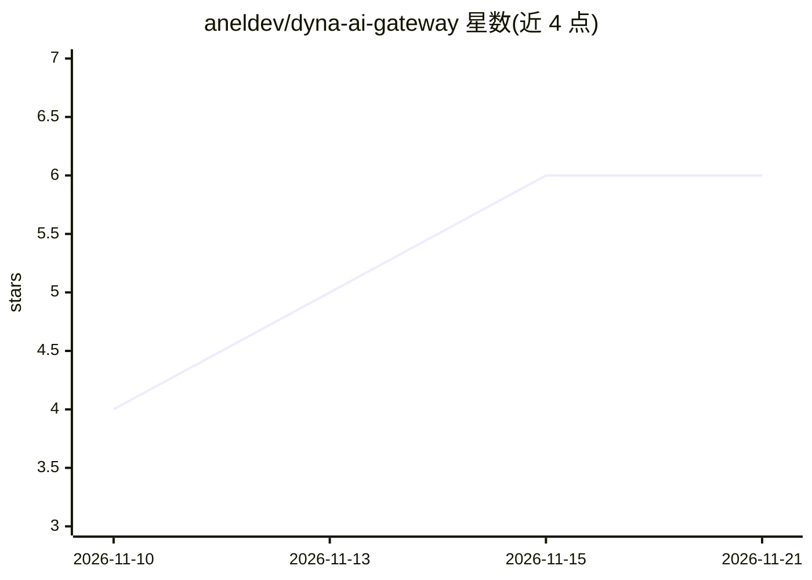

# aneldev/dyna-ai-gateway

⭐ 6 · TypeScript · MIT · 推送 2026-11-20 · [GitHub](https://github.com/aneldev/dyna-ai-gateway) · [官网](https://aneldev.github.io/dyna-ai-gateway/) · 组织维护

**服务端 TypeScript AI 网关库：为业务应用接入 LLM**

服务端 TypeScript 库，通过 Vercel AI SDK 以统一接口接入多家模型提供商。应用调用 ask() 获取回答或 run() 运行带工具的 agent，网关负责提示组装、会话历史、记忆、知识库（RAG）、工具策略、人工审批、用量控制、护栏与追踪。所有存储通过接口抽象，内置内存实现，MongoDB/PostgreSQL/S3 适配器为规划中的独立包。面向需要在业务应用中嵌入模型调用的开发者。

## 筛选速览

| 维度 | 判定 | 备注 |
|---|---|---|
| AI 角色 | `ai-ecosystem` | LLM/agent 周边工具 |
| 许可风险 | `permissive` | MIT |
| 部署形态 | `library` | 以包/库形式分发 |
| 模型依赖 | locked-api |  |
| 硬件要求 | — | 无带数字的原话,不猜 |
| 安装摩擦 | `low` | 无编译、无系统依赖或容器化 |
| 成熟度 | `idea` | |

## 能力要点

- ask()/run() 统一调用入口，支持流式与结构化回答
- 工具策略可对每次调用允许、拒绝或暂停等待人工审批
- 知识库按租户分块、嵌入与检索，支持查询改写与引用
- 所有存储为接口抽象，内置内存实现，可注入替换

## 适用场景

- 在业务系统中嵌入带人工审批的 agent 工具调用
- 按租户管理模型配置、用量与成本
- 为应用添加多租户 RAG 知识库问答

## 场景标签

`RAG` `模型网关` · 领域:Agent 开发

## 证据(README 行号)

> L17: A server-side TypeScript library that puts a language model inside a business application. The application calls
> L19: history, memory, knowledge base, tool policies, human approval, usage control, guardrails and tracing. Every provid
> L20: through the Vercel AI SDK; every store is behind an interface, with in-memory implementations

## 星数曲线

2026-11-10 4 → 2026-11-21 6（+2）

---
*卡片 v1 · prompt 1.4 · 生成 2026-11-20 · 置信度 high · 依据 README sha `cd2763aac256` · [字段定义](../../DATASET.md)*
