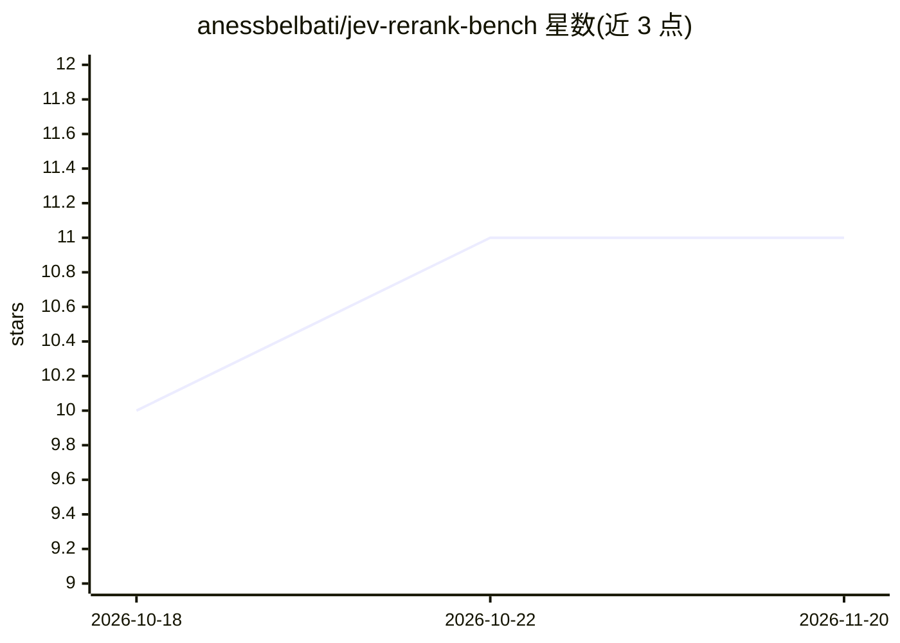

# anessbelbati/jev-rerank-bench

⭐ 11 · Python · MIT · 推送 2026-09-25 · [GitHub](https://github.com/anessbelbati/jev-rerank-bench) · [官网](https://anessbelbati.com/blog/i-gave-jev-a-rerankers-job) · 个人维护

**对 Jev 与多家重排模型在 14 个数据集上的 nDCG 评测基准**

包含重排实验、保存的原始 API 响应与打分代码的基准仓库：以 BM25 top-30 候选为统一输入，对 TypeSafe Jev、Cohere Rerank 4、ZeroEntropy zerank-2、DeepSeek、Qwen 等多个 API 与自托管模型在 8 个英文数据集及 BRIGHT、NevIR、MIRACL 法语子集上测量 nDCG@10、Top-1、延迟、成本、否定识别与校准。结果以 bootstrap 区间报告，不判定单一赢家。面向需要比较重排器表现的检索/RAG 从业者。

## 筛选速览

| 维度 | 判定 | 备注 |
|---|---|---|
| AI 角色 | `ai-ecosystem` | LLM/agent 周边工具 |
| 许可风险 | `permissive` | MIT |
| 部署形态 | `library` | 以包/库形式分发 |
| 模型依赖 | — | README 未给出锁定关系 |
| 硬件要求 | — | 无带数字的原话,不猜 |
| 安装摩擦 | `low` | 无编译、无系统依赖或容器化 |
| 成熟度 | — | 结构信号不足 |

## 能力要点

- 覆盖 14 个数据集、1,617 个打分问题的重排对比，保存每次原始 API 响应
- 同时测量排名质量（nDCG@10/Top-1/Recall@5/MRR）、延迟、成本、否定识别（NevIR）与校准（ECE）
- 对差距给出 95% bootstrap 区间，并声明未做多重比较校正
- 附 Qwen 开源方案复现实验与段落顺序敏感性、prompt 注入两个后续测试

## 适用场景

- 为 RAG 管线选择重排器时查看各模型的 nDCG、延迟与成本数据
- 评估候选重排模型在否定类查询上的表现
- 按仓库公开的打分代码自行测试其他模型

## 场景标签

`模型评测` · 领域:评测与运维

## 证据(README 行号)

> L8: it which ones were useful. Then I gave Cohere and ZeroEntropy the same passages. This repository contains the experi
> L97: Full tables, per-dataset numbers, latency percentiles, usage totals and every check: `results/summary.md`,

## 星数曲线

2026-10-18 10 → 2026-11-20 11（+1）

---
*卡片 v1 · prompt 1.4 · 生成 2026-11-18 · 置信度 high · 依据 README sha `45a7ce0c7a44` · [字段定义](../../DATASET.md)*
