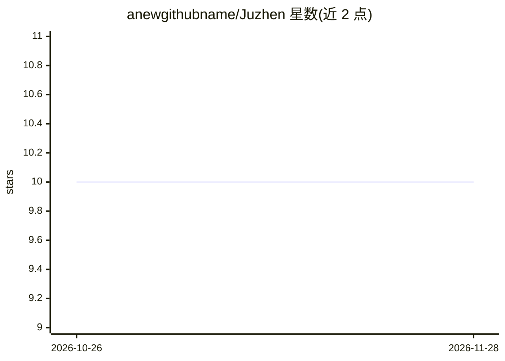

# anewgithubname/Juzhen

⭐ 10 · Jupyter Notebook · GPL-3.0 · 推送 2026-11-26 · [GitHub](https://github.com/anewgithubname/Juzhen) · 个人维护

**面向 C++ 开发者的矩阵运算 API，封装 BLAS/CUDA 等数值后端**

一组 C++ 矩阵运算 API，为 CBLAS、CUDA 等底层数值软件提供更高层接口；提供与 PyTorch/TensorFlow 类似的神经网络 API，含 cuDNN 支持的卷积层与 Apple Silicon 上的 Metal 后端。需 C++20 编译器，通过 CMake 按 CPU、NVIDIA CUDA、AMD ROCm/HIP、Apple Metal 等后端分别构建；仅可同时启用一个 GPU 后端。附带 16 个示例（MNIST/CIFAR-10 训练、Transformer、PageRank 等）与测试、基准脚本，训练示例将梯度计算与参数更新分离，支持检查点恢复。

## 筛选速览

| 维度 | 判定 | 备注 |
|---|---|---|
| AI 角色 | `ai-native` | 本体是模型或模型工具 |
| 许可风险 | `viral` | GPL-3.0 |
| 部署形态 | `desktop` | 安装包/桌面程序 |
| 模型依赖 | — | README 未给出锁定关系 |
| 硬件要求 | `cpu-ok` | |
| 安装摩擦 | `high` | 编译与系统依赖俱全 |
| 成熟度 | — | 结构信号不足 |

## 能力要点

- CPU/GPU 统一的矩阵 API，切换类型即可迁移到 CUDA/ROCm
- 神经网络层 API：卷积、转置卷积、预 LayerNorm Transformer 与 JVP 前向自动微分
- 四种后端：BLAS/CUDA/ROCm-HIP/Metal，通过 CMake 选项配置
- 内置 TimesFM 风格时间序列基础模型（CUDA）与匈牙利算法线性分配求解器

## 适用场景

- 在 C++ 项目中执行矩阵/线性代数运算而不直接写 BLAS 调用
- 用同一套代码在 CPU 与 GPU（CUDA/ROCm/Metal）上训练神经网络
- 在 AMD GPU 上运行 Transformer 前向/反向与 JVP 计算路径

## 场景标签

 · 领域:数值计算/机器学习基础库

## 证据(README 行号)

> L6: Juzhen is a set of C++ APIs for matrix operations. It provides a higher-level interface for lower-level numerical ca
> L13: - Neural-network layers including convolution, transposed convolution and pre-LayerNorm Transformers.
> L19: - A TimesFM-style time-series foundation model (CUDA), pretrained on public series and evaluated zero-shot on the C

## 星数曲线

2026-10-26 10 → 2026-11-28 10（+0）

---
*卡片 v1 · prompt 1.4 · 生成 2026-11-20 · 置信度 high · 依据 README sha `dbab19ba663b` · [字段定义](../../DATASET.md)*
