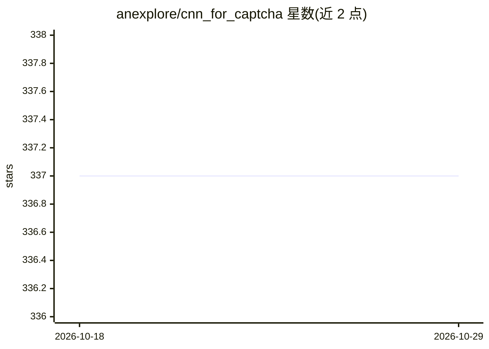

# anexplore/cnn_for_captcha

⭐ 337 · Python · Apache-2.0 · 推送 2026-03-19 · [GitHub](https://github.com/anexplore/cnn_for_captcha) · 个人维护 · 中文 README

**深度学习图片验证码识别方法集：覆盖五类验证码**

提供五类图片验证码的识别方案：固定长度文字验证码（CNN 分类训练与预测脚本）、滑动缺口验证码（OpenCV 模板匹配与 YOLOv5 目标检测）、点选文字验证码（目标标定加字符匹配思路）、旋转验证码（ResNet50 回归预测角度）、相似物体验证码（YOLOv5 物体探测）。各方案需自备标注训练数据，部分提供示例脚本与已标注图片；另记录了多模态大模型识别验证码的测试情况与提示词。依赖在 requirements.txt 中按需安装。

## 筛选速览

| 维度 | 判定 | 备注 |
|---|---|---|
| AI 角色 | `ai-native` | 本体是模型或模型工具 |
| 许可风险 | `permissive` | Apache-2.0 |
| 部署形态 | `None` |  |
| 模型依赖 | — | README 未给出锁定关系 |
| 硬件要求 | — | 无带数字的原话,不猜 |
| 安装摩擦 | `low` | 无编译、无系统依赖或容器化 |
| 成熟度 | — | 结构信号不足 |

## 能力要点

- 固定长度文字验证码 CNN 训练与预测（约 2 万张训练集实测 90% 以上准确率）
- 滑动缺口验证码双方案：OpenCV 模板匹配与 YOLOv5 检测
- 旋转验证码按回归问题处理，用 ResNet50 提取特征预测角度
- 附数据切分脚本与 labelme 转 YOLOv5 格式工具

## 适用场景

- 训练模型识别自己网站或目标场景中的文字/缺口/旋转验证码
- 参考点选与相似物体类验证码的标定和匹配思路
- 对比多模态大模型与专用模型在验证码识别上的表现

## 场景标签

`OCR` `目标检测` · 领域:感知与多模态

## 证据(README 行号)

> L8: **基于深度学习的图片验证码识别**
> L63: ### 2.2 基于YOLOv5的检测
> L142: **rotate_captcha.py** 中将旋转看作了回归问题, 使用ResNet50进行特征的提取；

## 星数曲线

2026-10-18 337 → 2026-10-29 337（+0）

---
*卡片 v1 · prompt 1.4 · 生成 2026-10-21 · 置信度 high · 依据 README sha `2196e4033546` · [字段定义](../../DATASET.md)*
