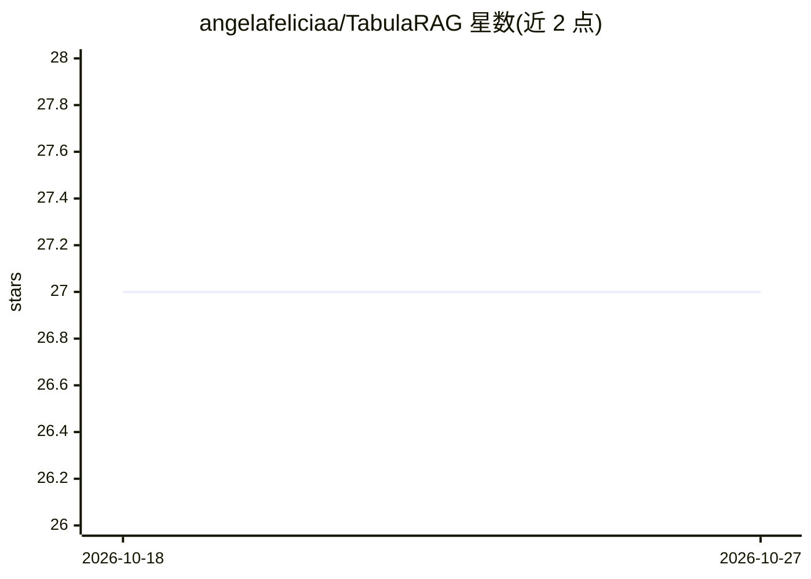

# angelafeliciaa/TabulaRAG

⭐ 27 · Python · MIT · 推送 2026-04-15 · [GitHub](https://github.com/angelafeliciaa/TabulaRAG) · [官网](https://tabularag.vercel.app) · 个人维护

**表格数据的 MCP RAG 检索工具，答案附单元格级引用**

面向 CSV/TSV 表格数据的检索问答服务：上传后自动识别表头、分隔符与列类型（日期/金额/度量），每行经 all-MiniLM-L6-v2 嵌入并存入 Qdrant，支持自然语言语义检索与基于 PostgreSQL JSON 列的 SQL 结构化查询，结果附单元格级引用。以 MCP 服务器（Streamable HTTP + SSE）暴露给 AI 助手，含多租户工作区、角色权限、邀请码、Google OAuth 认证。本地通过 Docker Compose 一键运行，无需本地安装 Python/Node。

## 筛选速览

| 维度 | 判定 | 备注 |
|---|---|---|
| AI 角色 | `ai-ecosystem` | LLM/agent 周边工具 |
| 许可风险 | `permissive` | MIT |
| 部署形态 | `self-host` | docker 或自建部署 |
| 模型依赖 | — | README 未给出锁定关系 |
| 硬件要求 | — | 无带数字的原话,不猜 |
| 安装摩擦 | `low` | 无编译、无系统依赖或容器化 |
| 成熟度 | — | 结构信号不足 |

## 能力要点

- CSV/TSV 摄取：自动表头检测、分隔符推断与列类型识别
- 行级嵌入（all-MiniLM-L6-v2）+ Qdrant 向量检索，结果带单元格级引用
- MCP 服务器（Streamable HTTP + SSE）供 AI 助手作为检索工具调用
- 多租户工作区与文件夹级访问控制（public/protected/private）

## 适用场景

- 让 AI 助手通过 MCP 查询我的 CSV/TSV 数据表
- 企业团队用多租户工作区共享表格数据并做权限管理
- 需要可溯源答案（单元格级引用）的表格问答

## 场景标签

`RAG` `文档问答` · 领域:知识与检索

## 证据(README 行号)

> L19: - **MCP server** — exposes Streamable HTTP + SSE endpoints so AI assistants can use your tables as a retrieval tool
> L38: TabulaRAG exposes endpoints for AI assistant integration:
> L4:  A fast-ingesting tabular data MCP RAG tool backed with cell citations.

## 星数曲线

2026-10-18 27 → 2026-10-27 27（+0）

---
*卡片 v1 · prompt 1.4 · 生成 2026-10-26 · 置信度 high · 依据 README sha `12f7c67b237b` · [字段定义](../../DATASET.md)*
