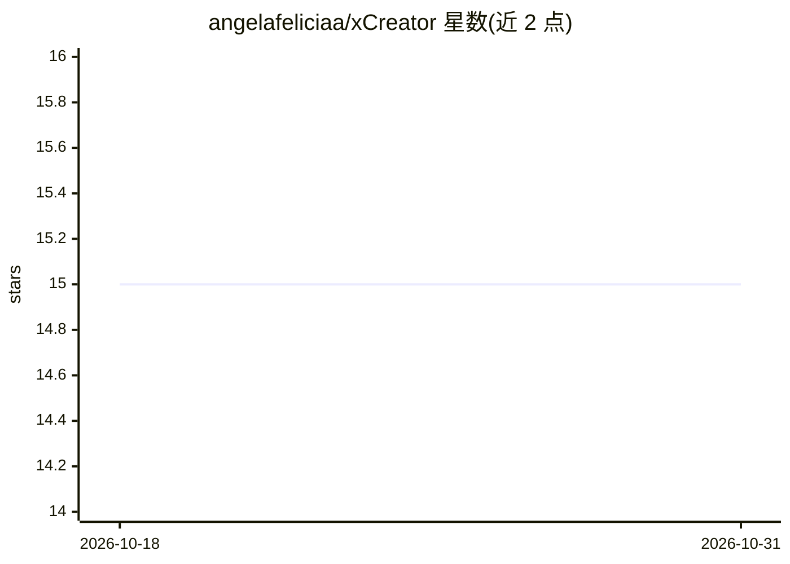

# angelafeliciaa/xCreator

⭐ 15 · TypeScript · 推送 2025-12-09 · [GitHub](https://github.com/angelafeliciaa/xCreator) · [官网](https://xai-kxyp.vercel.app/) · 个人维护

**品牌创建与管理网红营销活动的 UGC 平台**

基于 Next.js 15、TypeScript 与 Tailwind CSS v4 构建的用户生成内容平台，面向品牌方管理网红营销活动。功能含 5 步活动创建流程（活动信息、产品、创作者偏好筛选、内容交付要求、发布审核）、产品与品牌管理、收件箱消息系统及创作者查找。仓库主题标签含 embeddings、llm、semantic-search，但 README 未描述相关 AI 功能的具体使用方式。本地运行通过 npm install 与 npm run dev 启动。

## 筛选速览

| 维度 | 判定 | 备注 |
|---|---|---|
| AI 角色 | `ai-enhanced` | 去掉 AI 部分产品仍成立 |
| 许可风险 | `none` | — |
| 部署形态 | `library` | 以包/库形式分发 |
| 模型依赖 | — | README 未给出锁定关系 |
| 硬件要求 | — | 无带数字的原话,不猜 |
| 安装摩擦 | `low` | 无编译、无系统依赖或容器化 |
| 成熟度 | — | 结构信号不足 |

## 能力要点

- 5 步活动创建流程（活动/产品/创作者/资产/审核）
- 按年龄、地区、性别等条件筛选创作者偏好
- 含收件箱、品牌、产品、资产库等多个页面模块

## 适用场景

- 品牌方创建并管理网红营销活动
- 为活动指定产品与内容交付要求
- 按偏好条件筛选与合作创作者并沟通

## 场景标签

 · 领域:营销/内容平台

## 证据(README 行号)

> L3: A minimalistic User-Generated Content platform for brands to create and manage influencer campaigns.
> L11: - **Creator Preferences** - Filter creators by age, location, gender, ethnicity, and more

## 星数曲线

2026-10-18 15 → 2026-10-31 15（+0）

---
*卡片 v1 · prompt 1.4 · 生成 2026-10-30 · 置信度 low · 依据 README sha `fd18e565dd87` · [字段定义](../../DATASET.md)*
