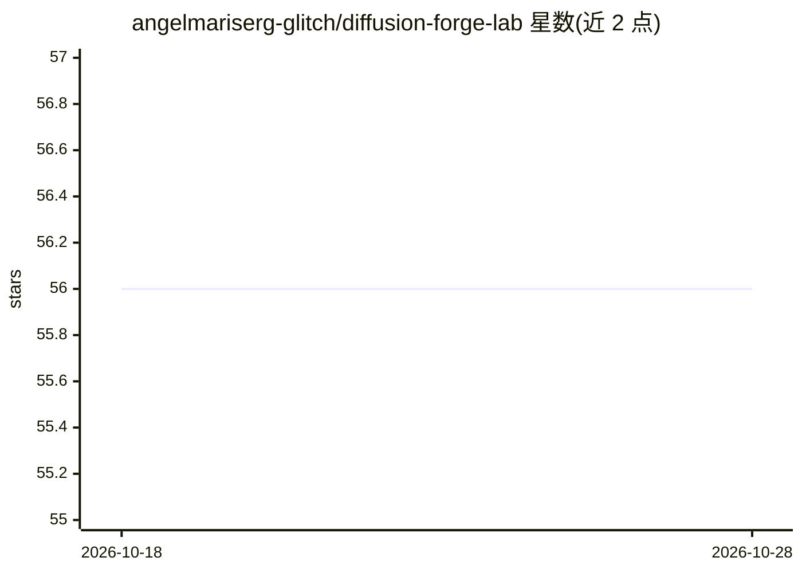

# angelmariserg-glitch/diffusion-forge-lab

⭐ 56 · HTML · 推送 2026-10-21 · [GitHub](https://github.com/angelmariserg-glitch/diffusion-forge-lab) · 个人维护

**面向 Diffusers 生态的声明式 LoRA/适配器微调编排框架**

以 YAML 声明式配方描述多阶段扩散模型微调流水线的 Python 框架：将各训练阶段组织为可链式、可分支、可复用的 weave，支持 LoRA、LoHa、LoKr、DyLoRA、OFT 与文本反转嵌入作为可热切换的一级适配器。提供本地浏览器 Studio Console 监控、潜变量缓存重放、配方 lint 与 dry run、检查点续跑等机制。依赖 Diffusers/Transformers/Accelerate 栈，支持 CUDA、ROCm、Apple Silicon 与 CPU 后端。面向研究者、独立创作者与工作室，自述为实验性框架。

## 筛选速览

| 维度 | 判定 | 备注 |
|---|---|---|
| AI 角色 | `ai-ecosystem` | LLM/agent 周边工具 |
| 许可风险 | `none` | — |
| 部署形态 | `None` |  |
| 模型依赖 | — | README 未给出锁定关系 |
| 硬件要求 | — | 无带数字的原话,不猜 |
| 安装摩擦 | `medium` | 含编译或系统依赖之一 |
| 成熟度 | `idea` | |

## 能力要点

- 声明式 YAML 配方引擎：链式/条件分支组织多阶段微调流水线
- LoRA/LoHa/LoKr/DyLoRA/OFT/文本反转适配器可中途热切换
- 潜变量缓存后跨多组超参重放，免重复编码数据集
- 配方 lint 与 dry run，无需消耗 GPU 时间即可验证配置

## 适用场景

- 用配置文件而非脚本组织 SD/SDXL/Flux 等模型的微调实验
- 在一组超参排列中复用已缓存的潜变量加速调参
- 长时训练任务的断点续跑与跨机器迁移

## 场景标签

`微调` · 领域:训练与推理

## 证据(README 行号)

> L14: Built as a spiritual successor to the ideas explored in lightweight, configuration-driven tuning systems, Semantic 
> L32: - 🧩 **Declarative Recipe Engine** — Define entire training journeys in structured YAML. Chain stages, branch condit
> L80: - The Hugging Face Diffusers and Transformers libraries at compatible versions

## 星数曲线

2026-10-18 56 → 2026-10-28 56（+0）

---
*卡片 v1 · prompt 1.4 · 生成 2026-10-24 · 置信度 high · 依据 README sha `5208ef19bae1` · [字段定义](../../DATASET.md)*
