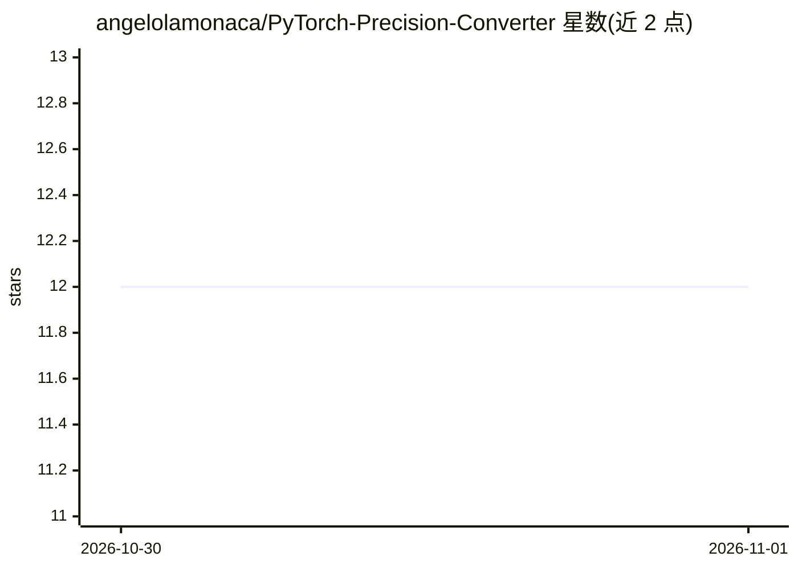

# angelolamonaca/PyTorch-Precision-Converter

⭐ 12 · Python · MIT · 推送 2026-10-29 · [GitHub](https://github.com/angelolamonaca/PyTorch-Precision-Converter) · [官网](https://pypi.org/project/pytorch-precision-converter/) · 个人维护

**一条命令转换 PyTorch/Hugging Face 模型文件精度的 CLI 工具**

Python 命令行工具（PyPI 包 pytorch-precision-converter），将 PyTorch checkpoint、safetensors 文件及 Hugging Face 模型目录在 fp16/bf16/fp8/fp8_scaled/int8_convrot/int8 之间转换，也可把 FP8 模型（DeepSeek、Qwen）在 CPU 上反量化回 BF16，并支持分片 safetensors 合并/拆分、EMA 权重提取。逐张量读写，转换 24 GB 模型无需 24 GB 内存；仅 CPU 运行，无需 GPU/CUDA/Triton，支持 Linux/macOS/Windows、Python 3.9+、PyTorch 2.1+。生成 ComfyUI 格式量化文件需 ComfyUI v0.4.0/v0.27.0 以上版本读取。

## 筛选速览

| 维度 | 判定 | 备注 |
|---|---|---|
| AI 角色 | `ai-ecosystem` | LLM/agent 周边工具 |
| 许可风险 | `permissive` | MIT |
| 部署形态 | `library` | 以包/库形式分发 |
| 模型依赖 | — | README 未给出锁定关系 |
| 硬件要求 | `cpu-ok` | |
| 安装摩擦 | `medium` | 含编译或系统依赖之一 |
| 成熟度 | — | 结构信号不足 |

## 能力要点

- fp16/bf16/fp8/fp8_scaled/int8_convrot/int8 多精度转换，含 FP8→BF16 反量化
- 逐张量流式读写，转换大模型无需等量内存
- 合并/拆分分片 safetensors、提取 EMA 权重、ckpt 转 safetensors
- --like 参照官方发布文件的分层量化选择，输出可达逐位一致

## 适用场景

- 把 Hugging Face 上的 FP8 模型转回 BF16 以便 CPU 使用
- 为 ComfyUI 制作 fp8_scaled/int8_convrot 量化模型文件
- 微调模型按官方发布的分层方案生成量化版本
- 合并或拆分分片 safetensors 并保留训练元数据

## 场景标签

`模型量化` · 领域:训练与推理

## 证据(README 行号)

> L9: Convert PyTorch checkpoints, `safetensors` files and whole Hugging Face model folders to **fp16, bf16, fp8 or
> L57: - **Runs anywhere.** CPU only: no GPU, CUDA or Triton needed. Linux, macOS and Windows, Python 3.9+, PyTorch 2.1+.

## 星数曲线

2026-10-30 12 → 2026-11-01 12（+0）

---
*卡片 v1 · prompt 1.4 · 生成 2026-11-01 · 置信度 high · 依据 README sha `271787cd0a0a` · [字段定义](../../DATASET.md)*
