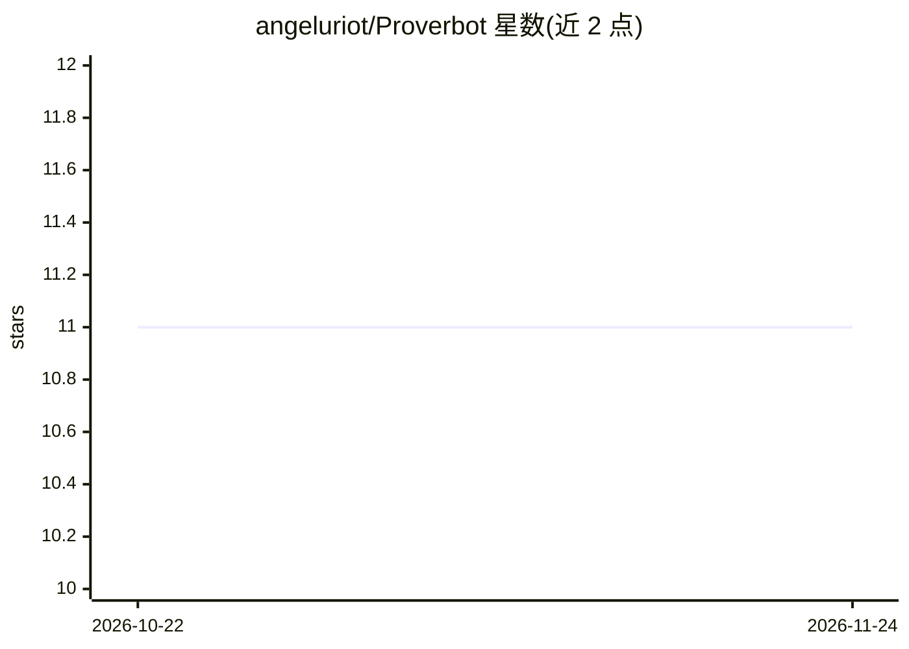

# angeluriot/Proverbot

⭐ 11 · TypeScript · MIT · 推送 2026-03-13 · [GitHub](https://github.com/angeluriot/Proverbot) · [官网](https://twitter.com/TheProverbot) · 个人维护

**生成随机法语谚语图片并发布到 Twitter 的机器人**

一个 Twitter 机器人项目：随机组合法语谚语文本，生成图片并定时发布到 Twitter 账号 TheProverbot。工作流程为生成图片（可指定数量）后启动机器人发布；配置需自备 DeepL API key 与 Twitter 应用的四组凭据，写入 .env 文件。仓库附带 example 示例数据（图片、字体与词库），用户需自行创建 data/generated/queue 目录并扩充自己的素材。

## 筛选速览

| 维度 | 判定 | 备注 |
|---|---|---|
| AI 角色 | `ai-native` | 本体是模型或模型工具 |
| 许可风险 | `permissive` | MIT |
| 部署形态 | `library` | 以包/库形式分发 |
| 模型依赖 | — | README 未给出锁定关系 |
| 硬件要求 | — | 无带数字的原话,不猜 |
| 安装摩擦 | `low` | 无编译、无系统依赖或容器化 |
| 成熟度 | — | 结构信号不足 |

## 能力要点

- 随机生成法语谚语图片并自动发推
- 支持指定数量批量生成图片（npm run gen -- 10）
- 提供 example 示例数据供替换为自制素材
- 通过 DeepL API key 与 Twitter API 凭据配置

## 适用场景

- 运营自动发布法语谚语图片的 Twitter 账号
- 批量生成谚语风格的文字图片素材
- 作为内容发布机器人的参考项目运行部署

## 场景标签

 · 领域:社交媒体/内容生成工具

## 证据(README 行号)

> L9: This repository contains the source code of a bot that generate random French proverb images and post them on Twitte
> L53: 		$ npm run gen -- 10

## 星数曲线

2026-10-22 11 → 2026-11-24 11（+0）

---
*卡片 v1 · prompt 1.4 · 生成 2026-11-18 · 置信度 mid · 依据 README sha `4f3817b996a1` · [字段定义](../../DATASET.md)*
