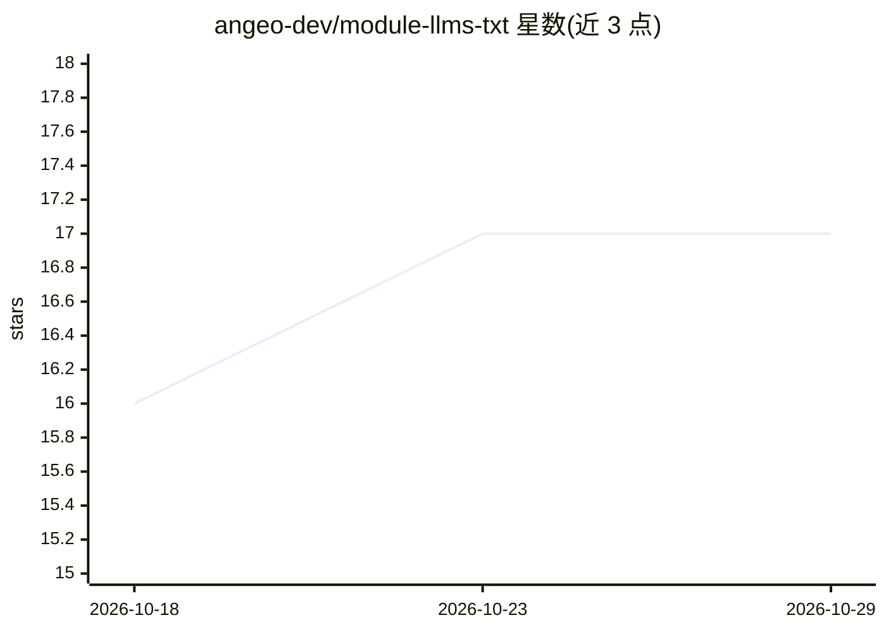

# angeo-dev/module-llms-txt

⭐ 17 · PHP · MIT · 推送 2026-09-16 · [GitHub](https://github.com/angeo-dev/module-llms-txt) · [官网](https://angeo.dev/) · 组织维护

**为 Magento 2 商店生成 llms.txt 等 AI 可摄取文件的模块**

Magento 2 / Adobe Commerce 扩展，为店铺目录生成符合 llmstxt.org v2 规范的 llms.txt、llms-full.txt、llms.jsonl，以及产品/分类/CMS 页面的即时 Markdown 镜像、agents.md 与 agentic discovery sitemap，供 ChatGPT、Claude、Gemini、Perplexity 等 LLM 爬虫摄取。通过 cron、CLI 或后台按钮触发生成，流式写入磁盘、原子重命名。处理多店铺、Page Builder 内容（DOMDocument 解析而非正则）、CMS 指令、客户组价格与 MSI 库存，导出可用性、图片与品牌等字段。MIT 许可，经 Composer 安装。

## 筛选速览

| 维度 | 判定 | 备注 |
|---|---|---|
| AI 角色 | `ai-ecosystem` | LLM/agent 周边工具 |
| 许可风险 | `permissive` | MIT |
| 部署形态 | `None` |  |
| 模型依赖 | — | README 未给出锁定关系 |
| 硬件要求 | — | 无带数字的原话,不猜 |
| 安装摩擦 | `low` | 无编译、无系统依赖或容器化 |
| 成熟度 | — | 结构信号不足 |

## 能力要点

- 生成 llms.txt / llms-full.txt / llms.jsonl / Markdown 镜像 / agents.md 六类输出
- 遵循 llmstxt.org v2 规范：link relations、describedby、per-store-code 子路径文件
- Page Builder 四种清洗策略（Preserve/Exclude/Allow/Strip），DOMDocument 解析处理嵌套容器
- 面向 AI 购物代理导出可用性（MSI 感知）、价格、图片与品牌属性

## 适用场景

- 让 ChatGPT、Claude、Gemini 等爬虫高效摄取我的 Magento 店铺目录
- 为 AI 购物代理提供库存、价格、政策页等机器可读信息
- 大型多店铺目录的 LLM 友好内容导出（流式、限内存）

## 场景标签

 · 领域:电商/AI 内容导出

## 证据(README 行号)

> L12: **AI Engine Optimization (AEO) for Magento 2 / Adobe Commerce.** Generates
> L13: spec-compliant `llms.txt`, `llms-full.txt`, and JSONL files so ChatGPT,
> L14: Claude, Gemini, Perplexity, and other LLM-powered crawlers can ingest your
> L81: This module produces that format for Magento, with care taken for the things

## 星数曲线

2026-10-18 16 → 2026-10-29 17（+1）

---
*卡片 v1 · prompt 1.4 · 生成 2026-10-29 · 置信度 high · 依据 README sha `cef033a8ff1e` · [字段定义](../../DATASET.md)*
