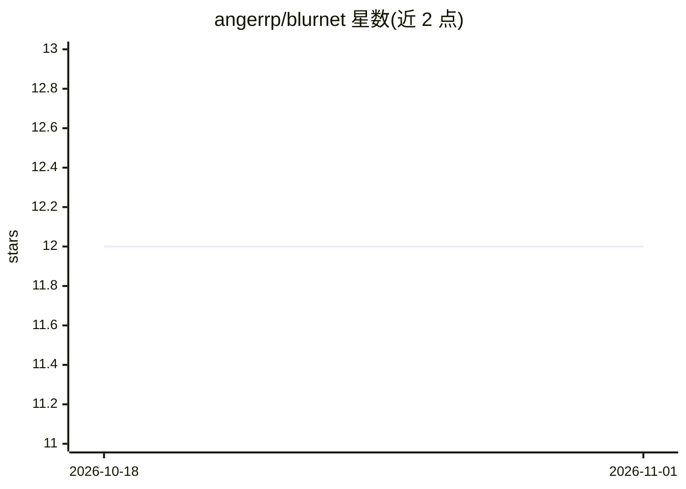

# angerrp/blurnet

⭐ 12 · Python · MIT · 推送 2026-08-10 · [GitHub](https://github.com/angerrp/blurnet) · 个人维护

**检测图像是否模糊的 CNN 分类模型（PyTorch Lightning）**

基于 PyTorch Lightning 实现的图像模糊检测 CNN：使用 Kaggle 上 1050 张模糊（运动模糊/失焦）与清晰图像训练。网络为两层卷积（7x7 与 5x5 卷积核，含 ReLU、最大池化、dropout）接两层全连接层。训练采用 EarlyStopping、批大小 128、96x96 裁剪输入，训练超 200 轮后准确率 81.91%。提供 pip 依赖安装、数据集划分脚本与训练脚本。面向需要模糊图像分类的开发者与科研用户。

## 筛选速览

| 维度 | 判定 | 备注 |
|---|---|---|
| AI 角色 | `ai-native` | 本体是模型或模型工具 |
| 许可风险 | `permissive` | MIT |
| 部署形态 | `library` | 以包/库形式分发 |
| 模型依赖 | — | README 未给出锁定关系 |
| 硬件要求 | — | 无带数字的原话,不猜 |
| 安装摩擦 | `low` | 无编译、无系统依赖或容器化 |
| 成熟度 | — | 结构信号不足 |

## 能力要点

- 两层卷积（7x7/5x5 核）加两层全连接的 CNN 架构
- 在 1050 张运动模糊/失焦/清晰图像数据集上训练
- 准确率 81.91%（训练超 200 epochs）
- 提供数据准备脚本与训练脚本

## 适用场景

- 从图片集中筛出模糊图像
- 学习 PyTorch Lightning 的 CNN 训练流程
- 作为模糊检测任务的模型起点

## 场景标签

`目标检测` · 领域:感知与多模态

## 证据(README 行号)

> L1: # Image Blur Detection
> L2: A blur detection model trained to detect blurry images. Implemented with pytorch lightning.

## 星数曲线

2026-10-18 12 → 2026-11-01 12（+0）

---
*卡片 v1 · prompt 1.4 · 生成 2026-11-01 · 置信度 mid · 依据 README sha `e3cba05caee4` · [字段定义](../../DATASET.md)*
