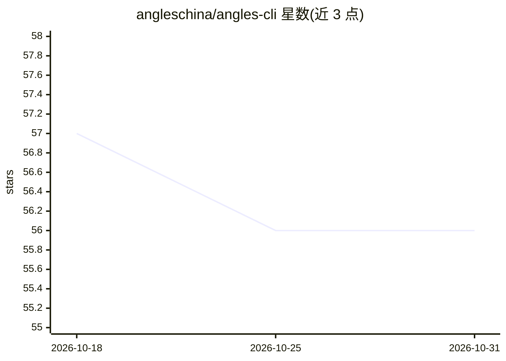

# angleschina/angles-cli

⭐ 56 · Rust · MIT · 推送 2026-09-12 · [GitHub](https://github.com/angleschina/angles-cli) · [官网](https://angleschina.github.io/angles-cli/) · 个人维护 · 中文 README

**单文件 Rust 编写的终端 AI 编码代理（1.6MB 静态二进制）**

Angles Code CLI 是编译为单一静态 Rust 二进制（约 1.6 MB）的终端原生 agentic 编码助手，零运行时依赖（无需 Node/Python）。代理通过 30+ 内置 angles-* 工具操作文件、目录、终端、Git 和 Web，可在 11 个模型提供方（OpenAI/Claude/Gemini/DeepSeek/GLM/Kimi 等）之间切换，采用各自原生协议并归一化流式与工具调用路径。v0.4.1 起执行前先生成 AI 操作计划；本地 HTTP 网关提供浏览器控制台。配置存于 ~/.angles/，API 密钥不经中转服务器。提供 Linux/macOS/Windows 共 5 个平台预编译二进制，支持 npm、curl、PowerShell 安装及源码交叉编译。

## 筛选速览

| 维度 | 判定 | 备注 |
|---|---|---|
| AI 角色 | `ai-native` | 本体是模型或模型工具 |
| 许可风险 | `permissive` | MIT |
| 部署形态 | `library` | 以包/库形式分发 |
| 模型依赖 | locked-api |  |
| 硬件要求 | — | 无带数字的原话,不猜 |
| 安装摩擦 | `low` | 无编译、无系统依赖或容器化 |
| 成熟度 | — | 结构信号不足 |

## 能力要点

- 单个 ~1.6 MB 静态 Rust 二进制，零运行时依赖
- 30+ 内置 angles-* 工具（文件/终端/Git/Web）
- 11 个模型提供方，原生协议归一化
- 执行前生成可见的 AI 操作计划；本地 axum HTTP 网关（angles serve）

## 适用场景

- 在终端用自然语言驱动 AI 完成读写文件、跑命令、Git 操作等编码任务
- 在 ARM64 开发板、iSH、Alpine、rootless 容器等受限环境部署编码代理
- 在不安装 Node/Python 工具链的机器上快速获得 agentic 编码工具
- 通过浏览器控制台切换模型提供方并测试对话

## 场景标签

`编码 Agent` · 领域:编码与开发

## 证据(README 行号)

> L29: Angles Code CLI is a terminal-native agentic coding assistant compiled into a **single static Rust binary (~1.6 MB)
> L35: |🤖 Providers|**11** (OpenAI / Claude / Gemini / DeepSeek / Grok / Qwen / GLM / Kimi …)|

## 星数曲线

2026-10-18 57 → 2026-10-31 56（-1）

---
*卡片 v1 · prompt 1.4 · 生成 2026-10-24 · 置信度 high · 依据 README sha `f7af774298f8` · [字段定义](../../DATASET.md)*
