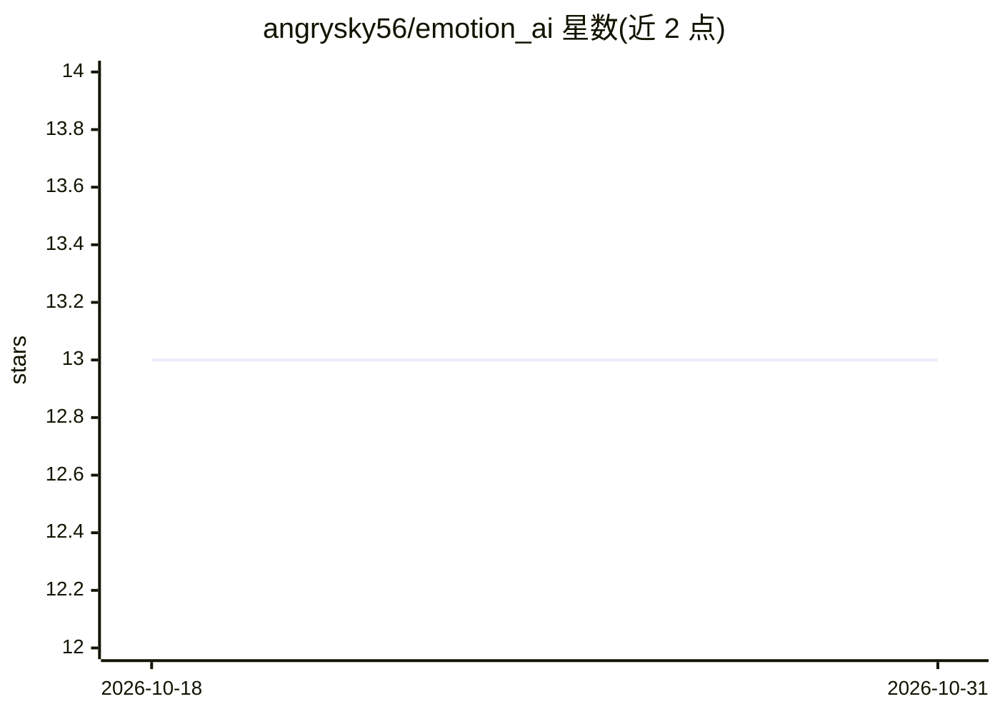

# angrysky56/emotion_ai

⭐ 13 · Python · 推送 2026-09-15 · [GitHub](https://github.com/angrysky56/emotion_ai) · 个人维护

**本地单用户 AI 伴侣后端：带情绪模拟与向量记忆**

基于 FastAPI 的私人单用户本地 AI 伴侣系统（Aura）：默认绑定 127.0.0.1、无登录层。核心机制包括 ChromaDB 向量语义检索、MemVid 的 .mv2 MP4 归档记忆（可选集成）、ASEKE 认知框架、模拟脑波与化学通道读数（README 明确标注为软件模拟而非实测生理数据）、以及 MCP 客户端/服务端工具接入。情绪评估采用带原文引句校验的暂定提案机制，本地 Ornith 评估 12 例中 1 例失败，README 明示这不构成可靠通用情绪识别的证据。模型提供方可选 Ollama 本地或 Gemini/OpenRouter 云端。作者自称非程序员，代码为 AI 生成，并附多项危险警告与免责声明。

## 筛选速览

| 维度 | 判定 | 备注 |
|---|---|---|
| AI 角色 | `ai-native` | 本体是模型或模型工具 |
| 许可风险 | `none` | — |
| 部署形态 | `self-host` | docker 或自建部署 |
| 模型依赖 | local-ok | 支持本地模型 |
| 硬件要求 | — | 无带数字的原话,不猜 |
| 安装摩擦 | `low` | 无编译、无系统依赖或容器化 |
| 成熟度 | — | 结构信号不足 |

## 能力要点

- ChromaDB 向量语义检索 + SQLite 会话存储 + 可选 MemVid .mv2 归档三层记忆
- MCP 客户端（兼容 Claude Desktop 配置格式）与服务端双向工具接入
- 情绪评估带原文引句校验与显式不确定性标注，失败分析保持 Unknown
- 本地 Ollama/fastembed 嵌入可免 API 成本运行

## 适用场景

- 在本地运行一个带长期记忆的私人 AI 伴侣
- 通过 MCP 配置接入外部工具生态
- 借助向量与归档记忆做跨会话对话检索

## 场景标签

 · 领域:对话式 AI 伴侣

## 证据(README 行号)

> L8: > **Sophisticated AI Companion with Vector Database, Emotional Intelligence, and Model Context Protocol Integration*
> L79: 1. **User Input** → Frontend → FastAPI
> L181: Aura is a private, single-user local application. It has no sign-in layer and

## 星数曲线

2026-10-18 13 → 2026-10-31 13（+0）

---
*卡片 v1 · prompt 1.4 · 生成 2026-10-31 · 置信度 mid · 依据 README sha `0efa9c1da5a0` · [字段定义](../../DATASET.md)*
