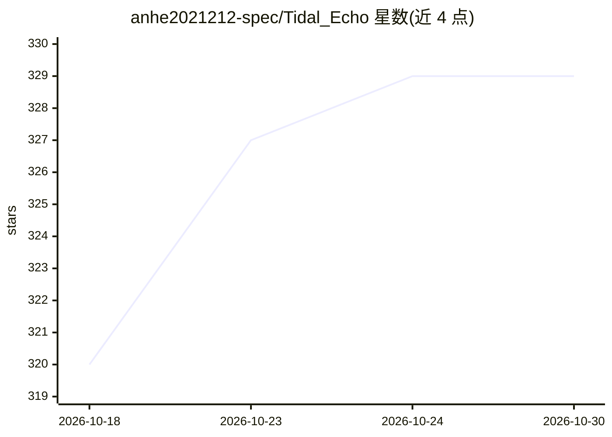

# anhe2021212-spec/Tidal_Echo

⭐ 329 · HTML · AGPL-3.0 · 推送 2026-09-22 · [GitHub](https://github.com/anhe2021212-spec/Tidal_Echo) · 个人维护 · 中文 README

**自托管私密 1:1 聊天通道：手机 PWA 连本地 AI 伴侣**

把手机上的 PWA 与本地运行的 AI 伴侣（默认 Claude Code channel 插件）连成单用户私密聊天通道，消息只经自己的 VPS（FastAPI + sqlite relay 后端 + SSE）。AI 侧不绑 Claude Code，可通过 examples/bridge_any_llm.py 或 api_loop.py 接任意 OpenAI 兼容 API（GPT/DeepSeek/Gemini 等），支持多模态附件、MCP 工具多步调用、人格热加载、MiniMax TTS 与 Web Push（可选项留空自动降级）。单密钥鉴权、无账号体系；PWA 需 HTTPS 域名，无构建步骤。部分菜单/相册为有意留白的占位。AGPL-3.0 许可。

## 筛选速览

| 维度 | 判定 | 备注 |
|---|---|---|
| AI 角色 | `ai-native` | 本体是模型或模型工具 |
| 许可风险 | `viral` | AGPL-3.0 |
| 部署形态 | `library` | 以包/库形式分发 |
| 模型依赖 | locked-api |  |
| 硬件要求 | — | 无带数字的原话,不猜 |
| 安装摩擦 | `low` | 无编译、无系统依赖或容器化 |
| 成熟度 | — | 结构信号不足 |

## 能力要点

- 三件套：relay 后端（FastAPI+sqlite+SSE）、Claude Code channel 插件（Bun+MCP）、单文件 PWA
- AI 侧可换任意 OpenAI 兼容 API，含兜底链与流式输出
- api_loop.py 支持 MCP 工具多步调用、多模态附件、人格热加载
- 单用户单密钥，无第三方托管，可选 TTS/Web Push 留空自动降级

## 适用场景

- 把手机当对讲机，随时和电脑上跑的 Claude Code 会话聊天
- 自托管一个不经过第三方服务的私密 AI 伴侣通道
- 换用 GPT/DeepSeek/Gemini 等 OpenAI 兼容 API 作为 AI 侧
- 只取 web/ 壳子接自己的消息后端（协议最小四端点即可跑通）

## 场景标签

`聊天机器人` · 领域:对话与助手

## 证据(README 行号)

> L3: 一个**私密 1:1 聊天通道**：把「你手机上的 PWA」和「你电脑上跑的 AI 伴侣」连起来。
> L4: AI 侧默认以 **Claude Code 的 channel 插件**形态运行——你在手机上发消息，Claude Code 会话里就冒出 `<channel>` 块；AI 调一个 `reply` 工具，你手机就收到气泡。**不绑 

## 星数曲线

2026-10-18 320 → 2026-10-30 329（+9）

---
*卡片 v1 · prompt 1.4 · 生成 2026-10-22 · 置信度 high · 依据 README sha `989040dc7ab8` · [字段定义](../../DATASET.md)*
