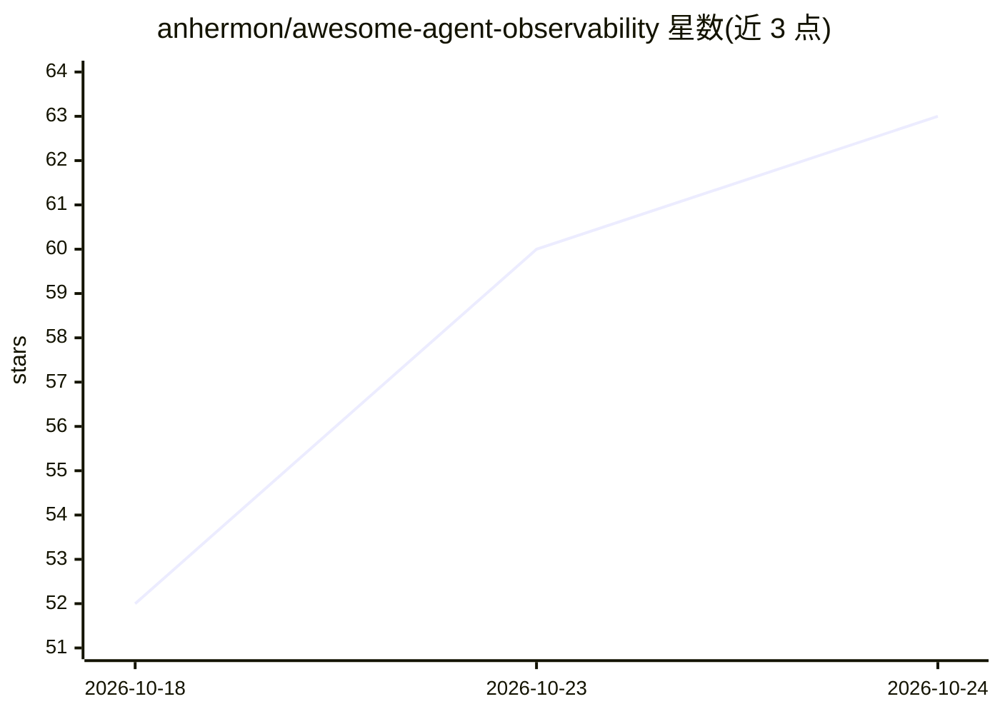

# anhermon/awesome-agent-observability

⭐ 62 · Python · CC0-1.0 · 推送 2026-10-18 · [GitHub](https://github.com/anhermon/awesome-agent-observability) · [官网](https://anhermon.dev) · 个人维护

**Agent 可观测性工具策展清单：追踪/评测/护栏/MCP**

面向 LLM 与 AI agent 应用开发者的策展清单（awesome list），收录追踪、评测、护栏、网关与 MCP 工具类目下的项目。条目描述项目功能并标注许可证；不活跃、停止维护或过新的项目被排除。维护者声明多数条目在 2026-10-04 审计时曾安装或构建运行过，另有每周任务检查各仓库是否存在、是否归档及是否有近期提交。清单覆盖 OpenTelemetry GenAI 语义约定等标准与多语言插桩库。

## 筛选速览

| 维度 | 判定 | 备注 |
|---|---|---|
| AI 角色 | `ai-knowledge` | 知识聚合/清单类 |
| 许可风险 | `viral` | CC0-1.0 |
| 部署形态 | `None` |  |
| 模型依赖 | — | README 未给出锁定关系 |
| 硬件要求 | — | 无带数字的原话,不猜 |
| 安装摩擦 | `low` | 无编译、无系统依赖或容器化 |
| 成熟度 | — | 结构信号不足 |

## 能力要点

- 按标准/追踪平台/评测/护栏/网关/MCP 等类别组织条目
- 条目标注许可证，排除休眠、停止维护或过新项目
- 每周自动检查仓库存在性、归档状态与近期提交
- 覆盖 OpenTelemetry GenAI 约定与 Python/JS/Java/Go 插桩库

## 适用场景

- 为 agent 应用选型追踪与可观测性平台
- 查找 LLM 评测框架与护栏/安全扫描工具
- 了解 MCP 可观测与网关工具生态

## 场景标签

`精选清单` · 领域:学习与行业

## 证据(README 行号)

> L1: # Awesome Agent Observability Awesome
> L3: > Curated tools, standards, and platforms for tracing, evaluating, and governing LLM and AI-agent applications.
> L5: Agents fail in ways ordinary services do not: a run is non-deterministic, spans a dozen model and tool calls, and "w

## 星数曲线

2026-10-18 52 → 2026-10-24 63（+11）

---
*卡片 v1 · prompt 1.4 · 生成 2026-10-24 · 置信度 high · 依据 README sha `5a75ef2a9646` · [字段定义](../../DATASET.md)*
