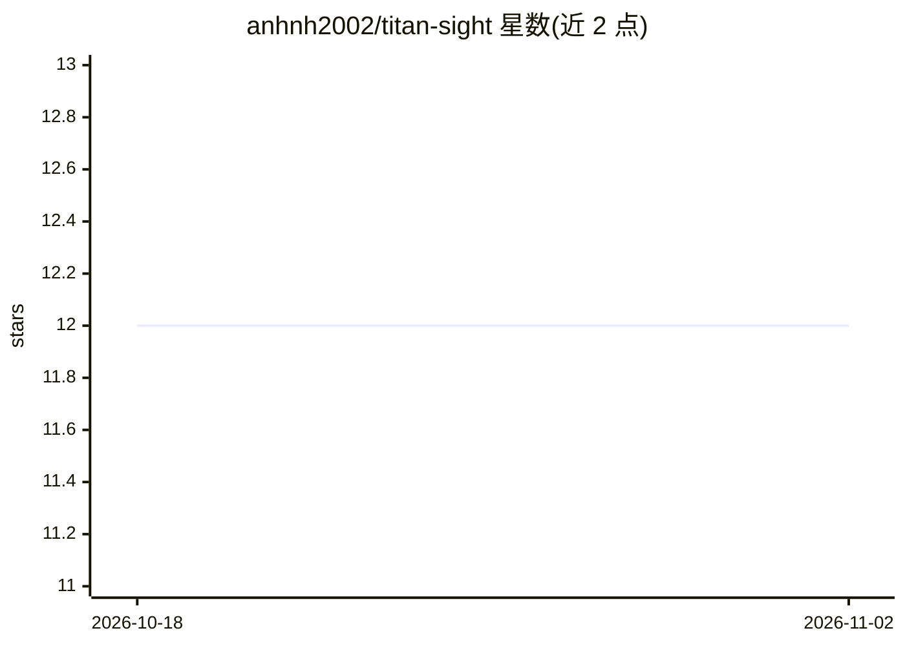

# anhnh2002/titan-sight

⭐ 12 · Python · 推送 2026-10-15 · [GitHub](https://github.com/anhnh2002/titan-sight) · 个人维护

**为 LLM agent 提供网页搜索 API 服务的后端系统**

面向 LLM agent 的网页搜索集成服务：将自然语言查询经 FastAPI 后端转换为结构化搜索结果，支持 SearXNG、DuckDuckGo、Google Custom Search 三种搜索提供方。提供查询级缓存（Redis 向量相似度）与页面级缓存（MongoDB），LLM 侧使用 OpenAI 兼容接口做结果摘要与 token 感知截断。通过 Docker 镜像与 docker-compose 部署，暴露 /v1/search REST 端点供 agent 调用。

## 筛选速览

| 维度 | 判定 | 备注 |
|---|---|---|
| AI 角色 | `ai-ecosystem` | LLM/agent 周边工具 |
| 许可风险 | `none` | — |
| 部署形态 | `self-host` | docker 或自建部署 |
| 模型依赖 | — | README 未给出锁定关系 |
| 硬件要求 | — | 无带数字的原话,不猜 |
| 安装摩擦 | `low` | 无编译、无系统依赖或容器化 |
| 成熟度 | — | 结构信号不足 |

## 能力要点

- 三种搜索提供方：SearXNG / DuckDuckGo / Google Custom Search
- 查询级 Redis 向量相似度缓存与 MongoDB 页面内容缓存
- OpenAI 兼容接口做结果摘要，支持 token 感知截断
- FastAPI 后端，Docker Compose 部署，/v1/search REST 端点

## 适用场景

- 为 LLM agent 接入实时网页信息的搜索 API
- 通过缓存层降低重复查询的搜索与抓取开销
- 自托管搜索服务以控制数据隐私

## 场景标签

`网页抓取` · 领域:效率与自动化

## 证据(README 行号)

> L3: Seamless web search integration for LLM agents. Transforms natural language queries into structured web data, enabli
> L18: - **Flexible LLM Integration**

## 星数曲线

2026-10-18 12 → 2026-11-02 12（+0）

---
*卡片 v1 · prompt 1.4 · 生成 2026-11-01 · 置信度 high · 依据 README sha `0eea70177300` · [字段定义](../../DATASET.md)*
