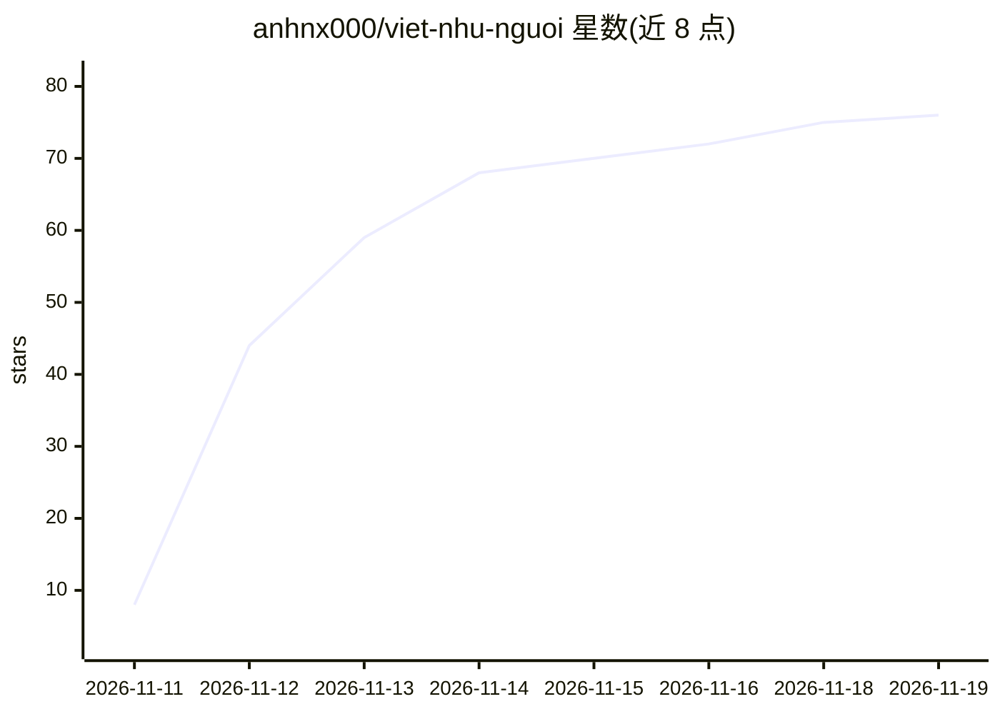

# anhnx000/viet-nhu-nguoi

⭐ 76 · Python · MIT · 推送 2026-11-16 · [GitHub](https://github.com/anhnx000/viet-nhu-nguoi) · [官网](https://github.com/anhnx000/vietnamese-humanizer#readme) · 个人维护 · 中文 README

**让 AI 用越南语自然人行文写作的 agent 技能包**

面向 Claude Code、Codex、Cursor、Gemini CLI、OpenCode 的 SKILL.md 格式技能：约束 AI 写越南语时去除翻译腔、公文体与套话，保持称谓角色与真实数据，用于邮件、幻灯片、长文与聊天回复。附带基于 Python 标准库的检测脚本 scan.py，对 .md/.txt/.pptx 按 0-100 分清点 AI 文风特征并输出行号；check_facts.py 比对修改前后的数据、日期、链接差异。安装支持助手代装、npx、git clone 与手动复制，不支持 Claude/ChatGPT 网页版。

## 筛选速览

| 维度 | 判定 | 备注 |
|---|---|---|
| AI 角色 | `ai-ecosystem` | LLM/agent 周边工具 |
| 许可风险 | `permissive` | MIT |
| 部署形态 | `library` | 以包/库形式分发 |
| 模型依赖 | — | README 未给出锁定关系 |
| 硬件要求 | — | 无带数字的原话,不猜 |
| 安装摩擦 | `low` | 无编译、无系统依赖或容器化 |
| 成熟度 | — | 结构信号不足 |

## 能力要点

- SKILL.md 技能形式，供 Claude Code/Codex/Cursor 等 agent 框架加载
- scan.py 按 0-100 分检测 AI 文风特征，支持 .md/.txt/.pptx 与 CI 退出码
- check_facts.py 比对原稿与改稿的数字、日期、链接增删
- 脚本仅用 Python 标准库，不联网、不收集数据

## 适用场景

- 让 AI 代写的邮件、汇报幻灯片读起来像自己写的
- 投稿或发文件前检测文本中的 AI 文风痕迹
- CI/pre-commit 中用分数阈值拦截模板化文案

## 场景标签

`AI 写作` `提示工程` · 领域:Agent 开发

## 证据(README 行号)

> L3: Skill cho Claude Code, Codex, Cursor: nhờ AI viết tiếng Việt mà đọc lên vẫn ra giọng mình. Bỏ câu sáo, xưng hô đúng 
> L169: Hai script chỉ dùng thư viện chuẩn của Python. `scan.py` chấm file `.md`, `.txt`, `.pptx`:

## 星数曲线

2026-11-11 8 → 2026-11-19 76（+68）

---
*卡片 v1 · prompt 1.4 · 生成 2026-11-18 · 置信度 high · 依据 README sha `930fd92fbd52` · [字段定义](../../DATASET.md)*
