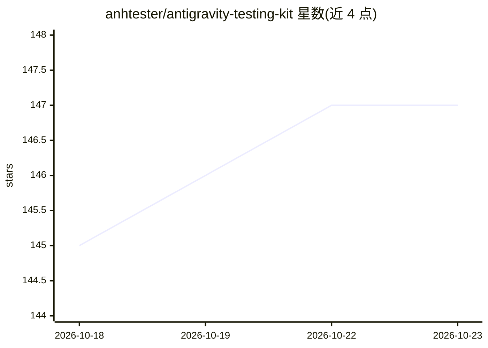

# anhtester/antigravity-testing-kit

⭐ 147 · JavaScript · MIT · 推送 2026-07-22 · [GitHub](https://github.com/anhtester/antigravity-testing-kit) · [官网](https://anhtester.com) · 个人维护 · 中文 README

**面向越南 Tester 社区的 Antigravity AI Agent 测试配置套件**

由 Anh Tester 维护的 Antigravity AI Agent 配置套件：提供 .agent 目录下的规则（rules）、技能（skills，含自动化、手工测试、定位修复、测试数据生成等 10 项）与工作流（16 个 slash 命令），覆盖从需求分析、测试用例设计到自动化脚本、CI/CD 与报告的测试全流程。附 6 步骤 Plan 流程、快速 Prompt 模板及 Jira/Xray、Google Sheets、Excel 转换辅助脚本。使用方式为 clone 仓库后将 .agent 目录复制到项目根目录，供 Antigravity 中的 AI 自动识别加载；AI 被配置为以越南语交流。

## 筛选速览

| 维度 | 判定 | 备注 |
|---|---|---|
| AI 角色 | `ai-ecosystem` | LLM/agent 周边工具 |
| 许可风险 | `permissive` | MIT |
| 部署形态 | `library` | 以包/库形式分发 |
| 模型依赖 | — | README 未给出锁定关系 |
| 硬件要求 | — | 无带数字的原话,不猜 |
| 安装摩擦 | `low` | 无编译、无系统依赖或容器化 |
| 成熟度 | — | 结构信号不足 |

## 能力要点

- 10 个测试专业技能（自动化工程、手工测试、定位修复、测试数据生成、Jira 集成等）
- 16 个 slash 命令工作流（从用例生成自动化脚本、RBT 手工用例、跨模块组合测试等）
- 10 类快速 Prompt 模板（生成需求、用例、Playwright/Selenium 框架与脚本、API 测试等）
- Jira/Xray 与 Google Sheets 集成脚本、Markdown 用例转 Excel 工具

## 适用场景

- 在 Antigravity 中按预设规则和技能生成手工测试用例或自动化脚本
- 按 6 步骤 Plan 流程完成需求分析到脚本评审的测试任务
- 通过集成脚本将测试结果同步到 Jira/Xray 或 Google Sheets

## 场景标签

`代码生成` · 领域:编码与开发

## 证据(README 行号)

> L5: Đây là bộ Kit được xây dựng và phát triển bởi **Anh Tester**, dành riêng cho **Cộng đồng Tester Việt Nam**. Mục tiêu
> L94: 3. **Bắt đầu trò chuyện với AI trên Antigravity:**

## 星数曲线

2026-10-18 145 → 2026-10-23 147（+2）

---
*卡片 v1 · prompt 1.4 · 生成 2026-10-22 · 置信度 mid · 依据 README sha `b4eeeb19c41e` · [字段定义](../../DATASET.md)*
