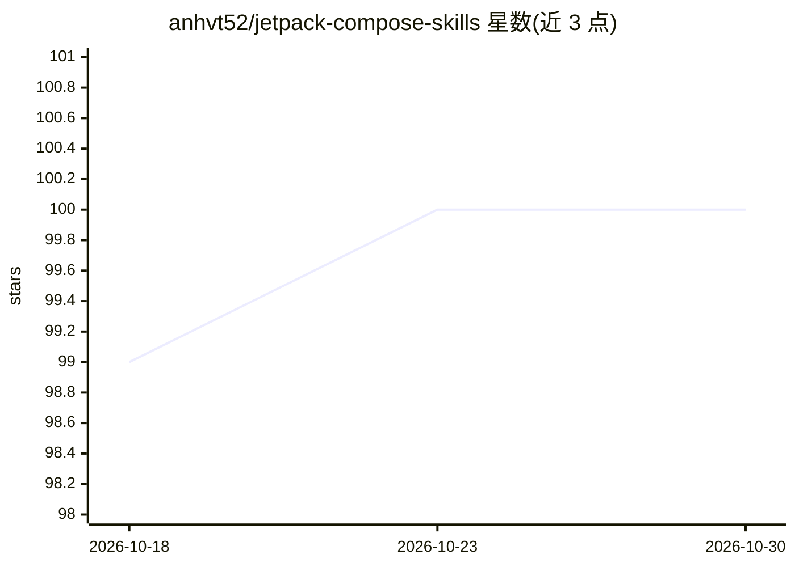

# anhvt52/jetpack-compose-skills

⭐ 100 · MIT · 推送 2026-03-12 · [GitHub](https://github.com/anhvt52/jetpack-compose-skills) · 个人维护

**面向 AI agent 的 Jetpack Compose 最佳实践参考技能**

以 Agent Skills 格式提供的知识包：包含 api/state/effects/recomposition/navigation/design/accessibility/performance 等 12 个参考文件，覆盖 Material 2→3 迁移、MVVM+UDF 状态管理、类型安全导航、无障碍与性能优化等主题。加载后供 Claude Code、Cursor、Codex、Gemini 等 agent 在生成与审查 Compose 代码时引用，输出按文件组织的问题清单与前后对比片段。通过 npx skills add 或手动克隆安装，MIT 许可，由个人维护。

## 筛选速览

| 维度 | 判定 | 备注 |
|---|---|---|
| AI 角色 | `ai-knowledge` | 知识聚合/清单类 |
| 许可风险 | `permissive` | MIT |
| 部署形态 | `library` | 以包/库形式分发 |
| 模型依赖 | — | README 未给出锁定关系 |
| 硬件要求 | — | 无带数字的原话,不猜 |
| 安装摩擦 | `low` | 无编译、无系统依赖或容器化 |
| 成熟度 | — | 结构信号不足 |

## 能力要点

- 12 个参考文件覆盖 API 迁移、状态管理、导航、无障碍、性能等主题
- 兼容 Claude Code、Cursor、Codex、Gemini 等 Agent Skills 平台
- 审查输出含文件行号、违反规则与前后代码对比

## 适用场景

- 让 AI 编码助手生成符合现代规范的 Compose 代码
- 审查现有代码中的过期 API 与反模式
- 按无障碍或性能主题做针对性检查

## 场景标签

`提示工程` · 领域:Agent 开发

## 证据(README 行号)

> L3: An agent skill for writing, reviewing, and reasoning about modern Android UI code
> L26: Load this skill to give your AI agent deep knowledge of modern Jetpack Compose best

## 星数曲线

2026-10-18 99 → 2026-10-30 100（+1）

---
*卡片 v1 · prompt 1.4 · 生成 2026-10-23 · 置信度 high · 依据 README sha `f5f50fa9ee93` · [字段定义](../../DATASET.md)*
