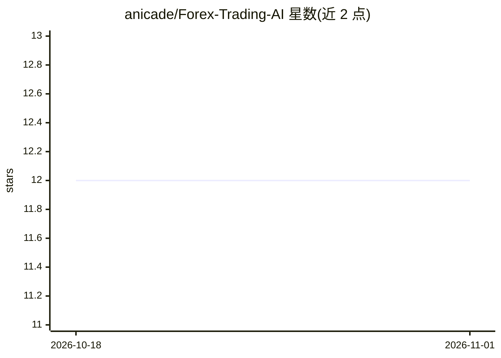

# anicade/Forex-Trading-AI

⭐ 12 · TypeScript · 推送 2026-02-27 · [GitHub](https://github.com/anicade/Forex-Trading-AI) · [官网](https://forextrading-ai.vercel.app) · 个人维护

**面向外汇与加密货币的 AI 交易信号生成 Web 应用**

基于 React + TypeScript + Vite 构建的 Web 应用：通过 OpenRouter 接入 LLM 做技术分析与概率评分，生成外汇与加密货币交易信号；集成 TradingView 实时图表，含外汇交易时段逻辑与玻璃拟态界面。用户需自行申请 OpenRouter API Key（写入 src/services/ai.ts 或设 VITE_OPENROUTER_API_KEY 环境变量），本地以 npm 安装并 npm run dev 运行，也提供 Vercel 一键部署路径。README 声明仅供教育用途，不构成投资建议。

## 筛选速览

| 维度 | 判定 | 备注 |
|---|---|---|
| AI 角色 | `ai-native` | 本体是模型或模型工具 |
| 许可风险 | `none` | — |
| 部署形态 | `library` | 以包/库形式分发 |
| 模型依赖 | locked-api |  |
| 硬件要求 | — | 无带数字的原话,不猜 |
| 安装摩擦 | `low` | 无编译、无系统依赖或容器化 |
| 成熟度 | — | 结构信号不足 |

## 能力要点

- 通过 OpenRouter LLM 生成带概率评分的交易信号
- 集成 TradingView 实时高级图表
- 支持外汇与加密货币实时数据分析及外汇市场时段逻辑
- 提供 Vercel 部署配置（vercel.json 路由）

## 适用场景

- 获取外汇/加密货币的 AI 生成技术分析信号
- 搭建自己的交易信号展示平台并部署到 Vercel
- 查看带实时图表的市场行情界面

## 场景标签

`金融量化` · 领域:学习与行业

## 证据(README 行号)

> L7: - **AI Signal Generation**: Utilizes powerful LLMs for technical analysis and probability scoring.
> L16: This app uses **OpenRouter** to access state-of-the-art AI models for generating trading signals.

## 星数曲线

2026-10-18 12 → 2026-11-01 12（+0）

---
*卡片 v1 · prompt 1.4 · 生成 2026-11-01 · 置信度 high · 依据 README sha `7e719bf3cc53` · [字段定义](../../DATASET.md)*
