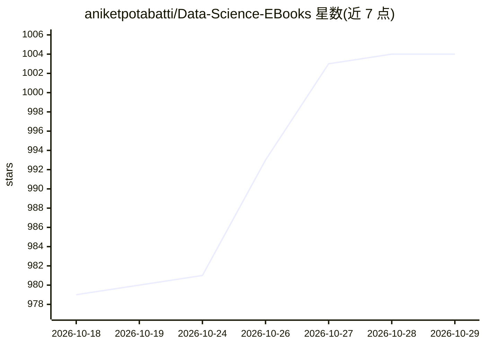

# aniketpotabatti/Data-Science-EBooks

⭐ 1,004 · 推送 2026-10-09 · [GitHub](https://github.com/aniketpotabatti/Data-Science-EBooks) · [官网](https://github.com/aniketpotabatti/Data-Science-EBooks) · 个人维护

**数据科学与机器学习电子书资源合集**

以仓库形式收录数据科学、机器学习及相关主题的电子书资源列表，供学习者查阅。README 仅说明仓库定位与贡献流程：社区可通过 fork、添加资源、提交 Pull Request 的方式补充电子书或文章，也可通过 issue 提出建议。未提供安装、运行方式，本体为静态资源清单。

## 筛选速览

| 维度 | 判定 | 备注 |
|---|---|---|
| AI 角色 | `ai-knowledge` | 知识聚合/清单类 |
| 许可风险 | `none` | — |
| 部署形态 | `None` |  |
| 模型依赖 | — | README 未给出锁定关系 |
| 硬件要求 | — | 无带数字的原话,不猜 |
| 安装摩擦 | `low` | 无编译、无系统依赖或容器化 |
| 成熟度 | — | 结构信号不足 |

## 能力要点

- 收录数据科学、机器学习相关主题的电子书资源
- 接受社区通过 Pull Request 补充资源
- 提供 issue 渠道收集建议与问题反馈

## 适用场景

- 查找数据科学与机器学习的电子书学习资源
- 向合集贡献自己掌握的学习资料

## 场景标签

`精选清单` · 领域:学习与行业

## 证据(README 行号)

> L2: ### This repository contains a collection of resources in the form of eBooks related to Data Science, Machine Learni

## 星数曲线

2026-10-18 979 → 2026-10-29 1,004（+25）

---
*卡片 v1 · prompt 1.4 · 生成 2026-10-21 · 置信度 high · 依据 README sha `df541104b7ba` · [字段定义](../../DATASET.md)*
