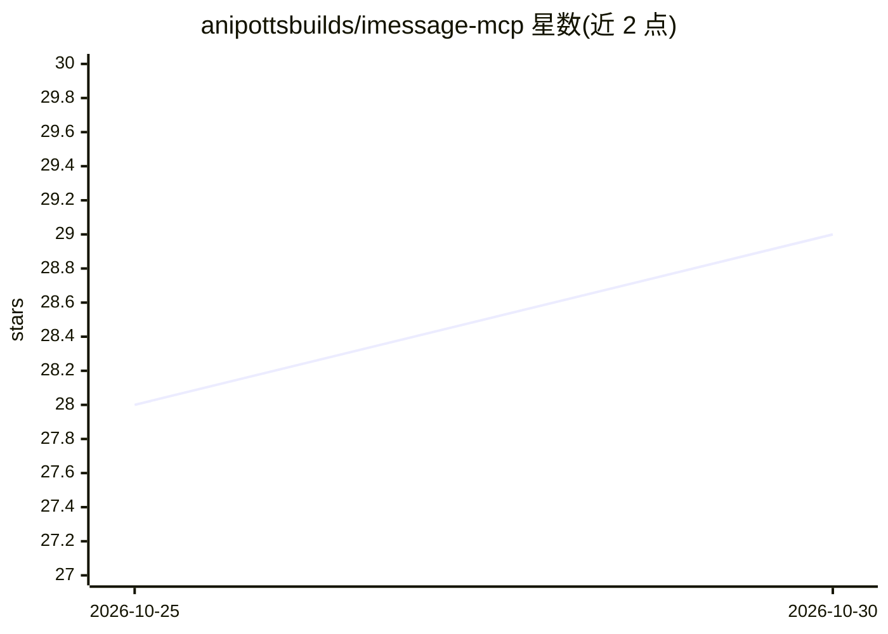

# anipottsbuilds/imessage-mcp

⭐ 29 · TypeScript · MIT · 推送 2026-10-26 · [GitHub](https://github.com/anipottsbuilds/imessage-mcp) · [官网](https://npmjs.com/package/imessage-mcp) · 个人维护

**本地只读读取 macOS iMessage 历史给 MCP 客户端的服务器**

运行在 Mac 上的只读 MCP 服务器：把本机 Messages 数据库（iMessage/SMS/MMS/RCS）以工具形式暴露给 Claude、Codex、Cursor、VS Code 等 MCP 客户端，支持按词/短语/精确文本搜索、整段对话读取（含编辑/撤回/回应/已读）、附件查看（去除位置元数据）、增量变更同步与消息统计分析。隐私分级（full/redacted/aggregate），无账号无遥测，需授予 Full Disk Access，要求 macOS 14+ 与 Node 24.16+，通过 npx 分发。

## 筛选速览

| 维度 | 判定 | 备注 |
|---|---|---|
| AI 角色 | `ai-ecosystem` | LLM/agent 周边工具 |
| 许可风险 | `permissive` | MIT |
| 部署形态 | `library` | 以包/库形式分发 |
| 模型依赖 | locked-api |  |
| 硬件要求 | — | 无带数字的原话,不猜 |
| 安装摩擦 | `low` | 无编译、无系统依赖或容器化 |
| 成熟度 | — | 结构信号不足 |

## 能力要点

- 8 个只读工具：搜索/读对话/列对话/附件/增量同步/统计分析/联系人解析/状态
- 隐私分级 full/redacted/aggregate，附件输出移除位置与相机元数据
- 本地运行，无账号无遥测，唯一网络请求是可选版本检查
- SQLite 搜索索引，支持加密缓存与 stdio/HTTP 两种传输

## 适用场景

- 让 AI 客户端帮我查找某条短信或整个对话
- 统计我的消息量、回复速度和最活跃的联系人
- 跟进新消息变更以同步我的短信记录到其他工具

## 场景标签

`数据分析` · 领域:效率与自动化

## 证据(README 行号)

> L5: Search and read your Messages history from Claude, Codex, Cursor, VS Code, and any other MCP client.
> L9: Read-only. Runs on your Mac. No accounts, no cloud service, nothing to compile.

## 星数曲线

2026-10-25 28 → 2026-10-30 29（+1）

---
*卡片 v1 · prompt 1.4 · 生成 2026-10-26 · 置信度 high · 依据 README sha `ac28d7d084ef` · [字段定义](../../DATASET.md)*
