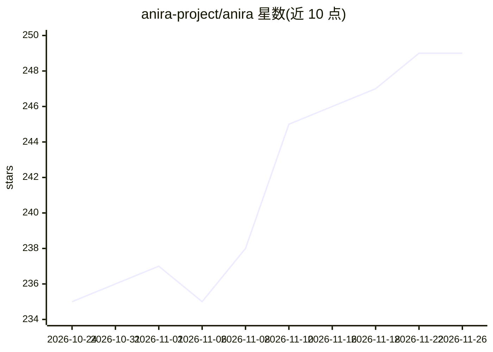

# anira-project/anira

⭐ 249 · C++ · Apache-2.0 · 推送 2026-11-22 · [GitHub](https://github.com/anira-project/anira) · [官网](https://anira-project.github.io/anira/) · 个人维护

**为实时音频应用提供实时安全的神经网络推理库**

C++ 库，用于在音频应用中集成神经网络推理并保证实时安全：线程池按进程共享管理推理线程、支持推理预算（budget）测量与固定、预热机制，内置基准测试工具评估实时性能。通过 JSON 模型文件与契约文件配置模型与运行方式。支持 ONNX Runtime、LibTorch、LiteRT、TensorFlow Lite、ExecuTorch 五种推理引擎及自定义引擎注册，支持有状态与无状态模型，覆盖 macOS/Linux/Windows/Android/iOS 与 WebAssembly。提供 CMake 集成（子模块/预编译二进制/源码构建）与 npm Web 包。

## 筛选速览

| 维度 | 判定 | 备注 |
|---|---|---|
| AI 角色 | `ai-ecosystem` | LLM/agent 周边工具 |
| 许可风险 | `permissive` | Apache-2.0 |
| 部署形态 | `desktop` | 安装包/桌面程序 |
| 模型依赖 | — | README 未给出锁定关系 |
| 硬件要求 | — | 无带数字的原话,不猜 |
| 安装摩擦 | `medium` | 含编译或系统依赖之一 |
| 成熟度 | — | 结构信号不足 |

## 能力要点

- 实时安全执行与确定性运行时设计
- 五种推理引擎支持及自定义引擎注册
- 内置基准测试工具评估神经网络实时性能
- JSON 模型文件与契约文件驱动配置，支持推理预算与预热

## 适用场景

- 在 JUCE/VST3/CLAP 音频插件中集成实时神经网络推理
- 对神经网络模型在音频场景下的实时性能做基准测试
- 在浏览器（WebAssembly）中运行音频模型推理

## 场景标签

`推理引擎` · 领域:训练与推理

## 证据(README 行号)

> L11: **Anira** is a high-performance library designed to enable easy real-time safe integration of neural network infere
> L19: - **Real-time Safe Execution**: Ensures deterministic runtimes suitable for real-time audio applications
> L177: Anira is available as the `@anira-project/anira` package for web applications: anira compiled

## 星数曲线

2026-10-24 235 → 2026-11-26 249（+14）

---
*卡片 v1 · prompt 1.4 · 生成 2026-11-25 · 置信度 high · 依据 README sha `67ef36f0f988` · [字段定义](../../DATASET.md)*
