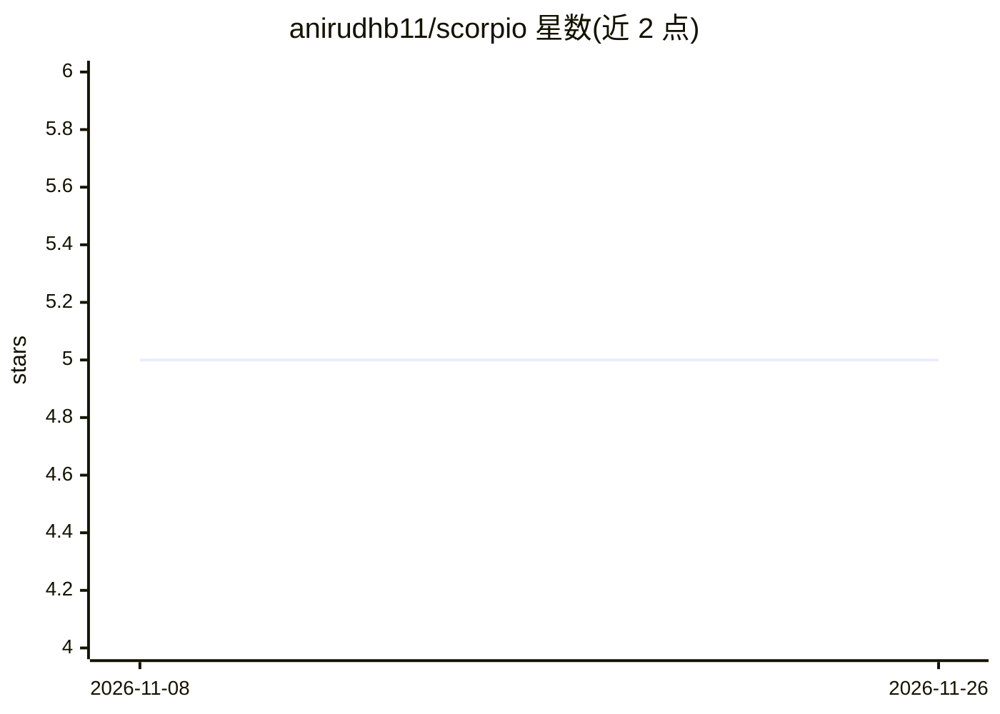

# anirudhb11/scorpio

⭐ 5 · Python · MIT · 推送 2026-11-04 · [GitHub](https://github.com/anirudhb11/scorpio) · [官网](https://anirudhb11.github.io/blog/scorpio/) · 组织维护

**论文配套代码：复现测试时计算自评估极限实验**

论文《On the Limits of Test-Time Compute for Self-Evaluation》的官方实现，围绕 LLM-as-judge 的偏差-方差分析流程组织为 prepare→post_process→score→report 四个 CLI 命令，输出准确率、bias²、方差随计算成本的变化。默认用 gpt-oss-20b，可切换 Qwen3.5-4B；支持自定义 scorer 文件、树搜索实验、多 GPU Slurm 分片运行。推理依赖 SGLang 运行时编译 kernel。

## 筛选速览

| 维度 | 判定 | 备注 |
|---|---|---|
| AI 角色 | `ai-native` | 本体是模型或模型工具 |
| 许可风险 | `permissive` | MIT |
| 部署形态 | `desktop` | 安装包/桌面程序 |
| 模型依赖 | — | README 未给出锁定关系 |
| 硬件要求 | — | 无带数字的原话,不猜 |
| 安装摩擦 | `medium` | 含编译或系统依赖之一 |
| 成熟度 | — | 结构信号不足 |

## 能力要点

- 四段式 CLI 流水线：采样/评分/报告/绘图，输出 bias²-variance 曲线
- 通过 scorpio/scorers/ 目录以单文件形式添加自定义 scorer
- Slurm sbatch 脚本支持按 GPU 分片处理数据集
- 内置 tree search 实验命令

## 适用场景

- 复现论文中测试时计算自评估的偏差-方差实验
- 在 HMMT/LCB/rg 数据集上评测不同 judge scorer
- 编写自己的 LLM-as-judge scorer 并纳入统一报告与绘图

## 场景标签

`模型评测` · 领域:评测与运维

## 证据(README 行号)

> L23: python -m scorpio.cli.prepare dataset=hmmt                             # sample and grade N=16 solutions per proble
> L26: python -m scorpio.cli.report dataset=hmmt scorer=scorpio               # accuracy, bias^2 and variance against cost

## 星数曲线

2026-11-08 5 → 2026-11-26 5（+0）

---
*卡片 v1 · prompt 1.4 · 生成 2026-11-21 · 置信度 high · 依据 README sha `6694765bd964` · [字段定义](../../DATASET.md)*
