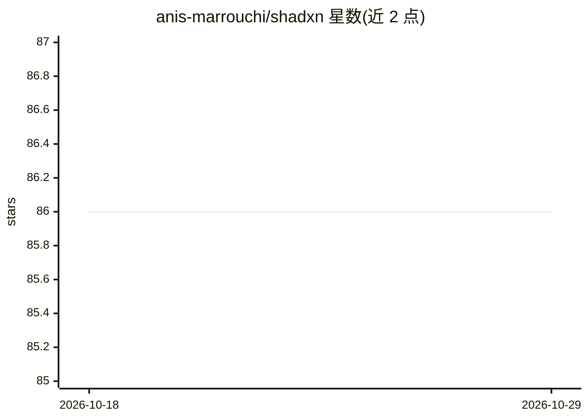

# anis-marrouchi/shadxn

⭐ 86 · TypeScript · 推送 2026-02-12 · [GitHub](https://github.com/anis-marrouchi/shadxn) · [官网](https://ui.shadxn.com) · 个人维护

**面向 AI 实验的单仓双包：agentx 代码生成引擎 + shadxn 组件注册表**

单仓包含两个包。agentx 是通用 agentic 代码生成引擎，提供 CLI 与库：读取自然语言任务，收集项目上下文（技术栈、schema、技能、库文档），发送给 Claude，生成输出文件；支持多步生成、auto-healing、运行时服务器、MCP server 模式、REPL、git 集成与 agent 间通信。shadxn 是组件注册表与代码变换系统，fork 自 shadcn-ui，管理组件注册表（shadcn、aceternity、自定义），处理 import/CSS/JSX/RSC 的 AST 变换，依赖 agentx 的共享工具。仓库声明为 AI 实验性质项目，MIT 许可。

## 筛选速览

| 维度 | 判定 | 备注 |
|---|---|---|
| AI 角色 | `ai-ecosystem` | LLM/agent 周边工具 |
| 许可风险 | `none` | — |
| 部署形态 | `library` | 以包/库形式分发 |
| 模型依赖 | — | README 未给出锁定关系 |
| 硬件要求 | — | 无带数字的原话,不猜 |
| 安装摩擦 | `low` | 无编译、无系统依赖或容器化 |
| 成熟度 | `idea` | |

## 能力要点

- 自然语言任务驱动的代码生成（generate/evolve/chat/serve）
- 支持 MCP server 模式、运行时服务器与 agent 间通信（A2A）
- AST 级变换处理 import/CSS/JSX/RSC
- 管理 shadcn、aceternity 与自定义组件注册表

## 适用场景

- 用自然语言生成或迭代项目代码（如 REST API、组件改造）
- 以 MCP server 或 REPL 方式集成代码生成能力
- 管理 shadcn 风格组件注册表并做代码变换

## 场景标签

`编码 Agent` `代码生成` · 领域:编码与开发

## 证据(README 行号)

> L9: General-purpose agentic code generation engine. CLI and library.
> L11: Takes a natural language task, gathers project context (tech stack, schemas, skills, library docs), sends it to Cla
> L25: Manages component registries (shadcn, aceternity, custom), handles AST transforms for imports/CSS/JSX/RSC, and reso

## 星数曲线

2026-10-18 86 → 2026-10-29 86（+0）

---
*卡片 v1 · prompt 1.4 · 生成 2026-10-24 · 置信度 high · 依据 README sha `c5d736224a97` · [字段定义](../../DATASET.md)*
