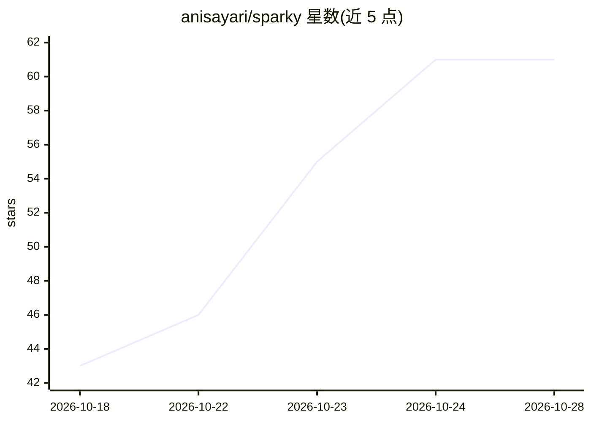

# anisayari/sparky

⭐ 61 · Python · MIT · 推送 2026-10-15 · [GitHub](https://github.com/anisayari/sparky) · 个人维护

**Windows 全本地 AI 助手：聊天/RAG/图像视频生成/语音/工具一体**

面向 Windows（x64/ARM64）用户的 100% 本地 AI 桌面助手。功能覆盖：流式聊天（四级思考深度、消息编辑与版本切换）、视觉识图、本地 RAG 文档问答（带编号引用）、文生图/文生视频（LTX-2.5 带同步声音）、多文件代码项目自动测试修复循环、Whisper 离线听写与 Piper 离线朗读、5 级安全等级的电脑操作模式、MCP 工具接入、定时任务与本地 OpenAI 兼容 API。安装方式为分步安装器，首次运行扫描硬件并推荐适配模型；云端模型（OpenRouter/Claude/Gemini 等）默认关闭。Sparky Bot 伴侣功能为 beta 状态。

## 筛选速览

| 维度 | 判定 | 备注 |
|---|---|---|
| AI 角色 | `ai-native` | 本体是模型或模型工具 |
| 许可风险 | `permissive` | MIT |
| 部署形态 | `desktop` | 安装包/桌面程序 |
| 模型依赖 | local-ok | 支持本地模型 |
| 硬件要求 | — | 无带数字的原话,不猜 |
| 安装摩擦 | `medium` | 含编译或系统依赖之一 |
| 成熟度 | `idea` | |

## 能力要点

- 本地 RAG 文档问答（multilingual-e5-small 嵌入 + 关键词检索，编号引用）
- Studio 文生图/文生视频，LTX-2.5 生成带同步声音的视频
- Computer mode 以 5 级安全等级操作本机文件与 PowerShell，含审批卡片
- MCP 服务器接入（stdio 与 Streamable HTTP，兼容 Claude Desktop 配置格式）
- 系统扫描后按硬件推荐模型，可复用 LM Studio/Ollama/HF 缓存中已有模型

## 适用场景

- 在 Windows 上离线使用带视觉与文档问答的 AI 聊天助手
- 本地生成与编辑图片、带声音的视频
- 把私人 PDF/Office 文档建成知识库并带引用提问
- 通过 OpenAI 兼容 API 在 VS Code 等工具中复用本地模型

## 场景标签

`AI 助手` `图像生成` `视频生成` `文档问答` · 领域:对话与助手

## 证据(README 行号)

> L5:  Your private AI assistant. 100% local.
> L6: Chat, see images, generate pictures and videos with sound, build apps, ask your documents, dictate and listen —
> L19: ### 💬 Chat

## 星数曲线

2026-10-18 43 → 2026-10-28 61（+18）

---
*卡片 v1 · prompt 1.4 · 生成 2026-10-24 · 置信度 mid · 依据 README sha `dcd9d9feea14` · [字段定义](../../DATASET.md)*
